<a class="bmc" href="https://buymeacoffee.com/jardimsonoro" rel="noopener">
    
</a>

# ☀️ Sunbliss

**"Overloaded A/D converter" mastering clipper and saturation, in Rust.**
A study project: black-box reverse engineering of the clipping plugins most used in the
industry, plus a from-the-manual recreation of the **Soft Saturation** and the output-stage
features of the **Lavry AD122-96 MkIII** converter.

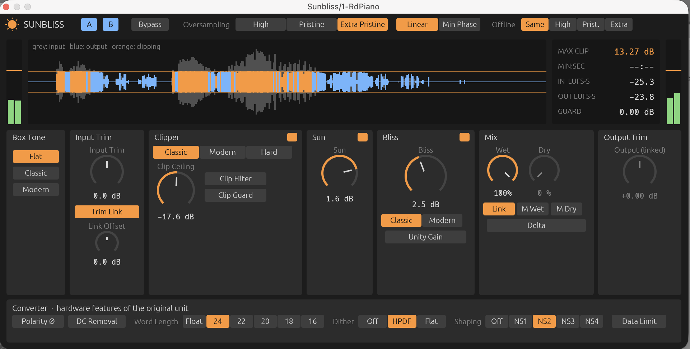

> **Notice: educational use.** This is a personal, non-commercial project with no affiliation to
> the manufacturers named here. Sunbliss's own binaries are published in the
> [releases](https://github.com/nagualcode/sunbliss/releases), free and without warranty. The
> plugins named here and "Lavry" are trademarks of their respective owners and appear only as a
> technical reference. Every number and curve in Sunbliss was derived by **measuring the output
> audio** of the reference and by reading the public manuals.

---

## Contents

1. [Results on one screen](#results-on-one-screen)
2. [Where the sound comes from](#where-the-sound-comes-from)
3. [How the reverse engineering was done](#how-the-reverse-engineering-was-done)
4. [The Lavry recreation](#the-lavry-recreation)
5. [Processing chain](#processing-chain)
6. [Control guide](#control-guide)
7. [Metrics](#metrics)
8. [Limitations and open items](#limitations-and-open-items)
9. [Install (prebuilt binary)](#install-prebuilt-binary) · [Build and reproduce](#build-install-and-reproduce)
10. [Repository layout](#repository-layout)

> **Naming.** Sunbliss's two voicing controls are called **Sun** (high-band taming near the
> ceiling) and **Bliss** (soft saturation). The reference plugin calls the same two blocks
> *Alchemy* and *Gold*; this README uses our names throughout, including where it describes
> what was measured on the reference. The reference plugin itself is not named anywhere in
> this documentation: it is "the reference plugin" throughout. Its own vocabulary survives
> only in the symbols read from its binary (`MXProcessor`, `SoftSaturationProcessor`,
> `mx_amount`) and in data and figure file names (`docs/fig/gc_*.png`,
> `docs/goldclip_params.json`, `lab/probe_alchemy*.py`).

---

## Results on one screen

| | Reference (another plugin) | Sunbliss |
|---|---|---|
| Sound parity (16 tests, criterion ≤ 0.5 dB) | — | **16/16**, worst case 0.21 dB |
| Bliss Classic curve vs. the Lavry manual's graph | within 0.21 dB of Sunbliss | **rms 0.03 dB** |
| Aliasing of a clipped high tone (12 cases) | −86 to **+20** dB | **−77 to −89 dB** (wins 11/12) |
| True-peak on a mix with the guard on | up to **+1.14 dBTP** | **≤ −0.14 dBTP** |
| Residual with everything neutral | −40.8 dBFS | **bit-transparent** |
| Latency (High, linear phase, 48 kHz) | 764 samples (reports 0 to the host) | **328** (reported correctly) |
| CPU, same host, High, stereo 48 kHz, 512 buffer (Mcycles per second of audio) | 113 | **68** (−40 %) |
| Formats | AU | CLAP · VST3 · AU v2 (auval OK) |

---

## Where the sound comes from

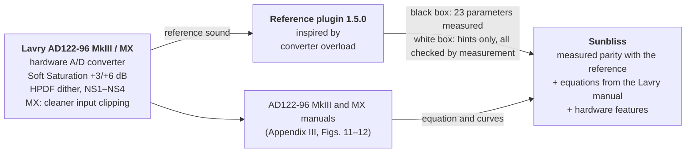

Sunbliss's sound has two origins:

1. **The reference plugin, measured from the outside.** The controls, the chain order, the
   clipper curves, the Bliss curves, Sun and Box Tone were measured on the plugin and
   reproduced until they were within 0.5 dB (in most cases within 0.1 dB).
2. **The Lavry converter, read from the manual.** The **Bliss Classic** mode is the Soft
   Saturation equation from Appendix III of the AD122-96 MkIII manual. The **Converter**
   section (polarity, DC, word length, HPDF dither, NS1–NS4 noise shaping, data limit)
   recreates features of the hardware that the reference plugin does not have.

Where the reference plugin and the hardware disagree, the project documents the difference and
picks a side. For example: the manual specifies 0.0008 % THD+N at −6 dBFS, i.e. the real
converter is transparent below the clip point. The low-level distortion of the reference's Classic
clipper (~0.5 % at −9 dBFS) is plugin coloration. We kept that coloration in Classic (for
parity), and the Modern and Hard modes stayed faithful to the hardware (THD < −170 dB below the
ceiling).

---

## How the reverse engineering was done

The work went through eight phases (F0–F7), always on the same principle: **every claim becomes
a reproducible test in `lab/`**, and every number in this README comes out of
`docs/data/*.json`.

### The measurement bench

- Two traps showed up right away in F0 and are compensated for in every render:
  - **Hidden latency:** the plugin reports 0 latency to the host, but its impulse-response peak
    sits at **764 samples** (44.1/48 kHz) and **1394** (88.2/96 kHz).
  - **Warm-up:** after a `reset()`, the first ~10k samples come out with the previous settings.
    Every render prepends 32768 samples of silence, which are then discarded.
  - **Host buffer:** part of the reference's behaviour is decided by the buffer size (see the
    ducking below). pedalboard defaults to 8192 samples, which exaggerated that effect in
    phases F1–F6. Since 2026-10-17 both plugins are measured with a **512-sample buffer**, as
    in a typical DAW.
- `lab/render.py` describes each setting once, in a neutral vocabulary, and translates it for
  both plugins. That way the reference and Sunbliss are always measured on the same grid.

### The test signals (`lab/stimuli.py`)

| Signal | What it is for |
|---|---|
| DC steps from −1.3 to +1.3 × ceiling | Static curve of each clipper, with no filter effect |
| 10 Hz sine near full scale | Curve of the saturations (memory < 1.5e−4, so it is a function of the input) |
| 1 kHz sine from −12 to +12 dB | RMS, THD and inharmonics per level |
| Noise at −40 dBFS + H1 transfer function | Linear frequency response (Box Tone, Clip Filter) |
| 5/9/13/15 kHz tones at +6 dB | Aliasing |
| Two tones, 19 + 20 kHz | Intermodulation |
| +12 dB bursts followed by a probe signal | Recovery after clipping |
| 12 s synthetic mix (`music_synth.py`) | Loudness (LUFS) and true-peak on music-like material |

### What we found

| Finding | How it was proved |
|---|---|
| **The chain order is clipper → Sun → Bliss**, not saturation → clipper as first assumed | The Bliss curve normalized by the ceiling is identical at 0 and −6 dB (8e−5 difference): it operates on an already limited signal |
| **Box Tone sits before** the Input Trim and the clipper | The 21 kHz harmonic of a clipped 7 kHz tone does not change with Tone (58.17 vs. 58.09 dB) |
| **Clip Filter** is a 1-pole low-pass at ~34 kHz, before the clipper (applied twice in Classic mode) | Clip harmonics identical with and without the filter (Δ ≤ 0.01 dB); identical response at 48 and 96 kHz |
| The **Classic clipper is a degree-9 polynomial**, asymmetric (H2 dominant already at −30 dBFS), valid up to 1.32 c. Above that an "overload memory" kicks in: the output decays to zero with τ = 72.5 ms | 262 DC plateaus: the degree-9 fit leaves a 1.4e−7 residual (the f32 floor); degrees 5 and 7 leave 5e−2 and 3e−2. Steps from 1.33 to 2.0 c decay together, ×0.708 every 25 ms |
| At extreme drive Classic **diverges**: from ~2.5 c on, the decay starts with inverted polarity | DC of 3.0 → −0.83, and a high tone at +18 dB (figure below). Treated as a defect and **not** reproduced |
| **Clip Guard** does almost nothing (−0.001 dB). What holds the peak is a per-sample clamp plus a hidden **ducking** of up to −2 dB, **decided by the host buffer** | DC steps of 2.0 and 4.0 produce −1 and −2 dB. The duration tracks the buffer: 230 ms with 8192, 60 ms with 2048, 5 ms with 512, nothing with 128 |
| The **true-peak escapes** by up to +1.04 dB above the ceiling | Measured with 8× oversampling |
| **Sun** splits the band with a linear-phase Linkwitz-Riley at 2965 Hz and pulls the high band down according to the level \|x\|/c, nearly instantaneously: it follows the waveform of a bass note (AM sidebands) but smooths that of a high tone (cubic average, τ 0.4 ms) | An 8 kHz probe riding DC plateaus (static law), carriers from 1.5 Hz to 1 kHz with a 15 kHz probe (dynamics) |
| The **Bliss Modern** curve is linear up to 0.5 c and then a C1 quadratic up to (c, c). Hence its "natural" maximum of +2.5 dB | Fit with error ≤ 0.06 dB (`docs/data/fit_modern_hermite.json`) |
| The reference's **Delta** includes the Input Trim gain, and its **Trim Link** only works in the GUI (automation does not see it) | Null tests |

Reference curves obtained in this phase:

| Clipper (DC) and Bliss curves | Clipped waveforms (note Classic at +18 dB, 1 kHz) |
|---|---|
| 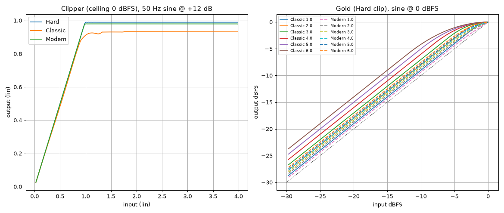 | 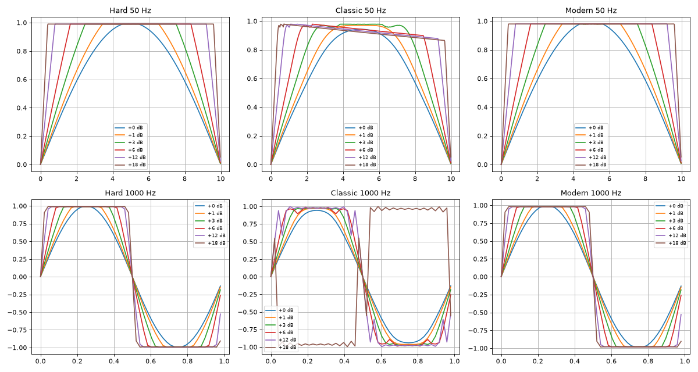 |

| Bliss curve gain per amount | Reference linear response (Box Tone, Clip Filter) |
|---|---|
| 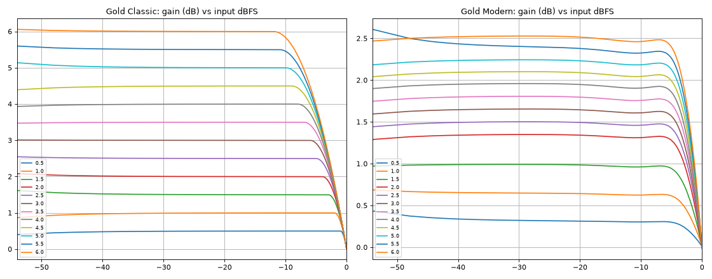 | 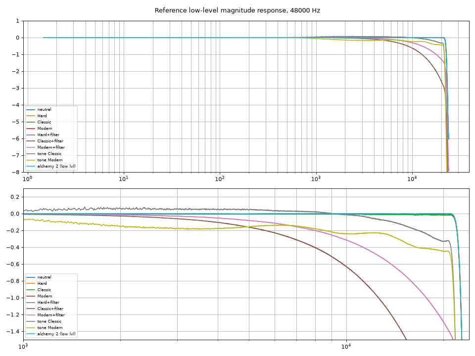 |

Sun's gain, measured on an 8 kHz tone while a bass note hits the ceiling. The modulation
follows the bass waveform sample by sample:

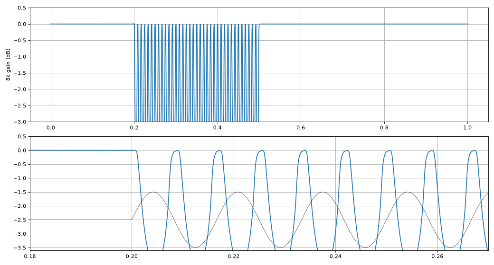

### Hidden states

The reference's oversampling (High/Pristine/Extra Pristine) and phase type (Linear/Minimum) are
**not parameters**: they live in an obfuscated state blob (`KLBW` header). We did not try to
decipher it. Instead, `lab/capture_gc_states.py` records the state after each choice made in
the plugin's own GUI, and those opaque states are reapplied before measuring
(`refs/goldclip_states/`).

### The phases

| Phase | Deliverable |
|---|---|
| F0 Environment | Rust/truce toolchain, pedalboard, reference latency and warm-up |
| F1 Inventory | 23 parameters mapped (`docs/goldclip_params.json`, `docs/CONTROLS.md`), chain confirmed (`docs/CHAIN.md`) |
| F2 Lab | Stimuli, metrics, comparative render, reference baseline in `docs/data/gc_*.json` |
| F3 DSP core | `crates/core` in f64, no allocation on the audio thread: oversampling, ADAA clipper, curves, guard |
| F4 Remaining blocks | Sun, Box Tone (`docs/TONE.md`), mixer/delta, unity, parity suite |
| F5 Plugin | CLAP/VST3/AU with [truce](https://crates.io/crates/truce), GUI, presets, A/B, meters |
| F6 Superiority | Suite that measures where Sunbliss beats the reference |
| F7 Blind test | ABX kit with loudness-matched pairs (`lab/abx.py`), awaiting listening with real music |
| F8 White box | Passive reading of the reference binary, lab at 512-sample buffer, polynomial Classic, Sun with the reference's dynamics (section below) |

### White-box reading of the binary

On 2026-10-17 the reference plugin's 1.5.0 binary was read **without executing it and without
deciphering anything**: the main code is protected by PACE (Fusion/Eden), and that was
respected. Only embedded strings, C++ class names (RTTI) and plain-text constant tables were
inspected. What turned up, and how each hint was used:

| Hint in the binary | What changed in the project |
|---|---|
| Built with JUCE 7 + chowdsp_utils. The processors are named `BoxToneProcessor`, `ClipperProcessor`, `MXProcessor` (Sun, parameters `mx_amount`/`mx_on_off`), `SoftSaturationProcessor` (Bliss), `DryWetProcessor` | Confirms the chain deduced in F1. The name "MX" links Sun to the **AD122-96 MX**, whose manual (now in `refs/manual/`) says the MX only changes the analog input clipping, with the same software as the MkIII |
| Clipper with `PolynomialWaveshaper<9>` and `<15>`, `HardClipper` and `chowdsp::ADAAWaveshaper` (table-based 2nd-order ADAA) | Suggested the "Classic is a polynomial" hypothesis. **Tested by black box**: 262 DC plateaus give a 1.4e−7 residual with degree 9 (`lab/fit_classic.py`). Sunbliss's Classic uses that own fit. The embedded coefficients only served as a cross-check: difference ≤ 2.7e−4 |
| A modified copy of JUCE's oversampling class, `OversamplingWithCeiling`, with its source embedded as text. After decimation it measures the **buffer's** sample peak, applies a ramped `ceiling/peak` gain and holds the minimum for two buffers | The "ducking with 0.4 s hold" was really pedalboard's 8192 buffer. **Confirmed by black box** (230 / 60 / 5 / 0 ms with 8192 / 2048 / 512 / 128), and the lab moved to a 512 buffer |
| Oversampling: equiripple half-band FIR (Linear) and **polyphase allpass IIR** half-band (Minimum), with JUCE's specifications | Explains the flat response up to 20 kHz and the 20–24 kHz aliasing. Studied for our own Min Phase mode (see open items) |
| `LinearPhaseCrossover` with a low-pass SVF prototype in `MXProcessor` | Suggested "Sun splits the band with a 2nd-order linear-phase filter". **Measured**: the low band is 1/(1+(f/2965 Hz)⁴), with 0.0024 error |
| `chowdsp::LinearPhaseEQ<PeakingFilter>` in Box Tone | Confirms "linear-phase linear EQ". Our FIR is already within 0.006 dB, so it was not re-fitted |

---

## The Lavry recreation

### Soft Saturation (Appendix III of the manual)

The manual describes two settings, **+3 dB** and **+6 dB**: linear gain up to a threshold
(−6 dBFS input at +3, −12 dBFS at +6) and, above it, an **exponential** curve whose slope
matches the linear part exactly ("slopes precisely equal to 22 bit accuracy"). The text does
not give the equation, only the graph.

We generalized it to a continuous knob **G** (0 to 6 dB), with gain `g = 10^(G/20)` and
threshold `T = 10^(−2G/20)`:

```
        ⎧ g·|u|                                   if |u| ≤ T
|y| =   ⎨
        ⎩ g·T + A·(1 − e^(−g·(|u| − T)/A))         if |u| > T
```

- The curve is C1 at the threshold (the derivatives on both sides equal `g`), as the manual
  requires.
- `A` is solved numerically so that **full scale comes out at full scale**: y(1) = 1 (closure
  "b").
- We digitized the manual's graph (222 points at +3, 306 at +6) and tested three closures.
  Closure (b) explains the graph with **rms 0.031 dB (+3) and 0.033 dB (+6)**. The asymptotic
  closure (a) predicts −0.22 dB at 0 dBFS, which contradicts both the graph and the MAX lamp
  ("indicates that the signal has reached full scale").
- The reference's Classic curve is within 0.21 dB of this equation. In other words, Bliss
  Classic **is** Lavry's Soft Saturation.

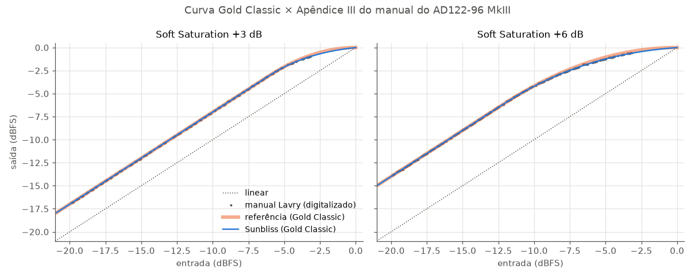

| Manual page (Appendix III) | Manual page (digitized graph) |
|---|---|
| 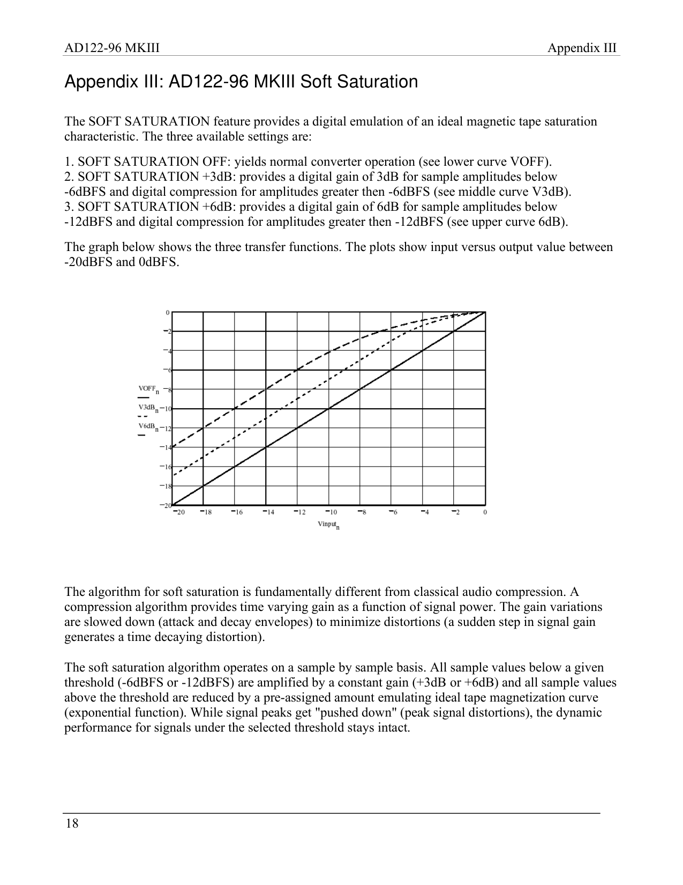 | 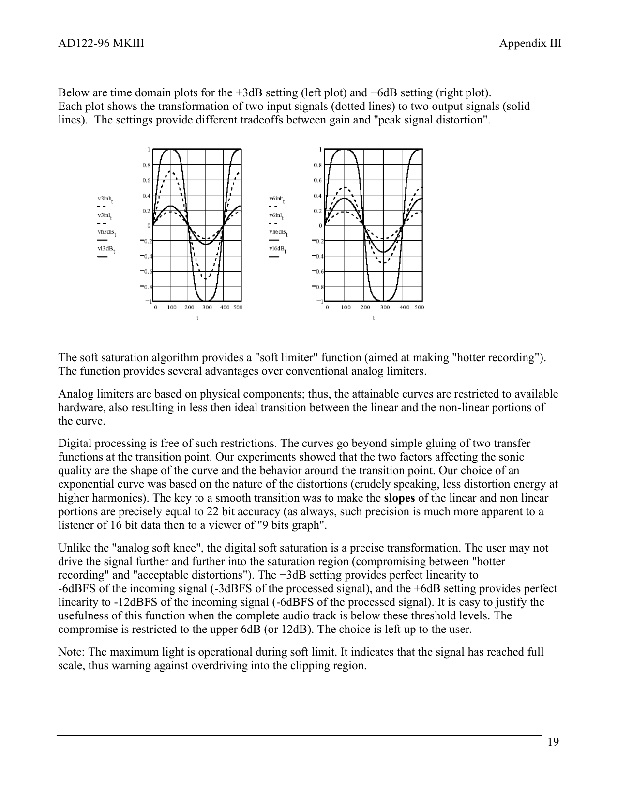 |

### The Converter section

The reference plugin does not model the converter's output stage. Sunbliss recreates those
features from Part I and Appendix I of the manual (`crates/core/src/lavry.rs`):

- **HPDF dither**, the manual's "triangle high pass": a new uniform random number minus the
  previous one. That gives triangular (TPDF) noise with a spectrum tilted towards the highs.
- **NS1–NS4 noise shaping**: 24th-order minimum-phase error feedback, with the curves traced
  from Figs. 11–12 (dips around ~4 kHz and ~12 kHz, noise pushed above 14 kHz). Measured at
  44.1 kHz/16 bit, relative to HPDF without shaping:

| | 1 kHz | 4 kHz | 8 kHz | 12 kHz | 16 kHz | 20 kHz | total noise |
|---|---|---|---|---|---|---|---|
| NS1 | −2.7 | −4.6 | −2.9 | −4.0 | +2.8 | +6.4 | −93.5 dBFS |
| NS2 | −6.3 | −9.6 | −4.7 | −6.4 | +6.8 | +11.6 | −88.5 dBFS |
| NS3 | −7.7 | −12.1 | −6.1 | −11.4 | +10.2 | +19.8 | −81.6 dBFS |
| NS4 | −9.6 | −20.8 | −10.5 | −10.1 | +14.2 | +29.4 | −72.6 dBFS |

The targets come from a printed graph: the shape is faithful, but the original coefficients are
not public.

---

## Processing chain

```mermaid
flowchart LR
    IN([input]) --> PRE[Converter, input<br/>Polarity Ø, DC Removal] --> TONE[Box Tone<br/>linear-phase FIR] --> TRIM[Input Trim] --> UP["↑ oversampling<br/>4/8/16×"]
    UP --> CF[Clip Filter<br/>optional] --> CLIP[Clipper<br/>Classic/Modern/Hard<br/>2nd-order ADAA] --> SUN[Sun] --> BLISS[Bliss] --> DOWN["↓ decimation<br/>alias-free"]
    DOWN --> LIM[Output limiter<br/>peak / true-peak] --> UNITY[Unity Gain] --> MIX{Mix<br/>Wet/Dry/Delta}
    PRE -. "dry (latency-delayed)" .-> MIX
    MIX --> OUT[Output Trim] --> CONV[Converter, output<br/>word length, dither,<br/>shaping, data limit] --> BYP[Bypass<br/>crossfade] --> Y([output])
```

- All non-linear processing runs at the oversampled rate.
- The clipper uses **2nd-order ADAA** (antiderivative anti-aliasing) over tabulated curves. On a
  9 kHz tone clipped at 4×, that gives −82 dB of aliasing, against −64 dB for 1st-order ADAA.
- Sun splits the band at 2965 Hz (linear-phase Linkwitz-Riley, in an interpolated FIR) and
  applies the reference's gain law at the oversampled rate, with no separate detector and no
  lookahead.
- The decimator rejects **everything from fs/2 up** (100 dB). The reference's is half-band and
  lets aliasing through in the 20–24 kHz range.
- The output limiter has a fixed ~1.8 ms lookahead, so latency does not change when Clip Guard
  is switched on. The dry path is delayed to match.
- Details and proofs: [`docs/CHAIN.md`](docs/CHAIN.md).

---

## Control guide

The option order and defaults **follow the reference plugin**, so a setting can be copied from
one plugin to the other, and so do the labels — except for the two voicing controls, which
carry our own names: **Sun** (the reference's *Alchemy*) and **Bliss** (its *Gold*). On
controls that behave differently, the GUI shows a tooltip explaining the difference (marked
**≠** below).

### Top bar

| Control | What it does |
|---|---|
| **A / B** | Two setting memories. Clicking toggles between them; Alt-click copies the current setting to the other one. They are saved with the DAW session. |
| **Bypass** | Switches processing off with a crossfade (no click). The output stays latency-aligned, so toggling it does not shift the audio. |
| **Oversampling: High / Pristine / Extra Pristine** | How far the rate is raised before the non-linearities: 4×, 8× and 16× at 44.1/48 kHz (half of that at 88.2/96 kHz). More oversampling = less aliasing and more CPU. |
| **Linear / Min Phase** | Type of the oversampling filters. *Linear*: no phase rotation, more latency, symmetric pre-ringing. *Min Phase*: less latency (250 against 328 samples), no pre-ringing, a slight phase rotation near the highs. |
| **Offline: Same / High / Prist. / Extra** | Uses a different quality for offline render/bounce only (for example High while mixing and Extra on export). *Same* = the same as real time. |

### Meters

| Meter | What it shows |
|---|---|
| **Waveform** | Grey = input, blue = output, orange = where clipping happened. |
| **MAX CLIP** | The largest clipping since the last reset, in dB above the ceiling (measured at the clipper input). |
| **MIN:SEC** | Where in the DAW timeline that maximum happened. Double-click resets both. |
| **IN / OUT LUFS-S** | Short-term (3 s) loudness at the input and the output, for level-matched comparison. |
| **GUARD** | How much the output limiter or Clip Guard is pulling down, in dB. |

### Box Tone

Linear coloration (EQ only, no distortion), applied **before** the clipper. It stays within
tenths of a dB and only acts above ~400 Hz.

| Option | Sound |
|---|---|
| **Flat** | Nothing. It is bit-transparent (in the reference, the neutral path is not). |
| **Classic** | +0.03 to +0.06 dB of brightness between 1 and 6 kHz and a gentle roll-off above 10 kHz. |
| **Modern** | A 0.2 dB dip between 2 and 10 kHz, falling to −0.45 dB at 18 kHz. |

Switching options crossfades over 10 ms. Measurements in [`docs/TONE.md`](docs/TONE.md).

### Input Trim

| Control | What it does |
|---|---|
| **Input Trim** (−12…+12 dB) | Gain before the clipper. This is the "drive": the higher it is, the further the signal goes past the Clip Ceiling and the more it is clipped. |
| **Trim Link** ≠ | Links the Output Trim to the Input Trim inversely: +3 dB at the input means −3 dB at the output. That way you hear the effect of the clip without the "louder = better" illusion. *Difference:* in Sunbliss the link also applies to automation and to the host. In the reference plugin it only works through the GUI. |
| **Link Offset** (−12…+12 dB) | With the link on, adds a fixed gain to the output: Output = −Input + Offset. |

### Clipper

| Control | What it does |
|---|---|
| **On/off** (orange square) | Enables the clipper. With it off, Bliss ignores the ceiling and works relative to 0 dBFS, as in the reference. |
| **Classic** ≠ | The "old-school" converter model: soft, **asymmetric** compression from low levels on (2nd harmonic, warmer sound), following the degree-9 polynomial measured on the reference. Above 1.32 of the ceiling the plateau **sags** while the overload lasts (τ = 72.5 ms), which gives body to the lows. *Difference:* it does not reproduce the reference's polarity inversion at extreme drive (from ~2.5× the ceiling on). |
| **Modern** | Linear up to ~90 % of the ceiling, with a short knee up to 0.98 of it. Clean below the ceiling and slightly softer than Hard. |
| **Hard** | Linear up to the ceiling, then a straight cut. The most transparent up to the clip point and the "hardest" past it. |
| **Clip Ceiling** (−36…0 dB) ≠ | The clipper's ceiling. Sun and Bliss use that same ceiling as their reference. *Difference:* Sunbliss does not do the hidden ducking of up to −2 dB that the reference applies after strong attacks. There it is decided by the host buffer and lasts two buffers (~5 ms with 512, ~0.2 s with 8192). Here the peak is held by a soft limiter that does not depend on the buffer. |
| **Clip Filter** | Gentle low-pass (1 pole, ~34 kHz) before the clipper. It rounds ultrasonic transients and makes the clip a little less harsh. In Classic mode the effect is doubled (−2.6 dB at 20 kHz). |
| **Clip Guard** ≠ | Guarantees that the **true-peak** (the real peak after D/A conversion) stays 0.15 dB below the ceiling. *Difference:* in the reference this button barely changes anything and the true-peak goes up to +1 dB past the ceiling. With the guard off, Sunbliss holds *sample* peaks at the ceiling. |

### Sun

| Control | What it does |
|---|---|
| **On/off** | Enables Sun. |
| **Sun** (0…2 dB) | Softens the highs **only when the signal gets near the ceiling**: the band above ~3 kHz (2965 Hz crossover) comes down by up to −4 dB at 2 dB of amount. It tames the harshness the clip creates on peaks without darkening the rest of the music. As in the reference, the gain follows the waveform of the lows: a kick hitting the ceiling makes the cymbals "breathe" (AM sidebands). On high-frequency signals it is smoothed (τ 0.4 ms), so it does not distort the high tone itself. The law, the crossover and the dynamics were measured on the reference and match within 0.07 dB. |

### Bliss

| Control | What it does |
|---|---|
| **On/off** | Enables the saturation. |
| **Bliss** (0…6 dB) | Soft saturation **after** the clipper. It adds gain at low and mid levels and rounds the approach to the ceiling: the music gets denser and louder without going past the ceiling. |
| **Classic** ≠ | Lavry's Soft Saturation from the manual: exactly G dB of gain below −2G dBFS and an exponential curve up to the ceiling. At 6 dB, full gain up to −12 dBFS. The strongest and most "full-bodied" one. |
| **Modern** | A more restrained curve: linear up to half the ceiling and a parabolic transition up to it. Maximum gain is +2.5 dB (the knob at 6 is worth ~2.5 dB of real gain). More transparent than Classic. |
| **Unity Gain** | Compensates Bliss's gain at the output (Classic 6 → −6 dB, Modern 6 → −2.5 dB). Useful for comparing with and without saturation at the same volume. |

### Mix

| Control | What it does |
|---|---|
| **Wet** (0…100 %) | Level of the processed signal, in linear amplitude (50 % = −6 dB). |
| **Dry** (0…100 %) | Level of the original signal, latency-delayed so it sums in phase. Enables "parallel" clipping. |
| **Link** | Keeps Dry = 100 − Wet (a single blend control). |
| **M Wet / M Dry** | Mutes the wet or the dry path without losing the settings. |
| **Delta** ≠ | Plays only the **difference** between processed and original: you hear exactly what the plugin is removing or adding. *Difference:* Sunbliss discounts the Input Trim, so the delta shows only the processing, not the trim gain. |

### Output Trim

| Control | What it does |
|---|---|
| **Output Trim** (−12…+12 dB) | Final gain, after the mix (affects both wet and dry). With Trim Link on, the label becomes "Output (linked)" and the value is computed automatically. |

### Converter: features of the original hardware

Polarity Ø and DC Removal act at the input (before the dry split, so parallel use stays
coherent). Word Length, Dither, Shaping and Data Limit act last, at the output, as in the unit.
None of them exist in the reference plugin.

| Control | What it does |
|---|---|
| **Polarity Ø** | Inverts the polarity (digital, crossfading through zero). |
| **DC Removal** | Removes DC with a 0.3 Hz high-pass that settles in < 3 s, like the hardware's DC REMOVAL. It acts before the clipper, so DC does not shift the clip point. |
| **Word Length: Float / 24 / 22 / 20 / 18 / 16** | Output bit depth. *Float* reduces nothing. The other options quantize, to deliver for example a 16-bit master for CD. |
| **Dither: Off / HPDF / Flat** | Noise that makes quantization linear (no low-level distortion). *HPDF* is Lavry's "triangle high pass", the manual's preference. *Flat* is plain TPDF, recommended in the manual for data-compressed destinations. It only acts when Word Length is not Float. |
| **Shaping: Off / NS1–NS4** | Pushes the dither noise into frequencies where the ear is less sensitive (above 14 kHz), lowering it around 4 kHz and 12 kHz. NS1 is the gentlest, NS4 the most aggressive. It switches itself off when Dither is Off, as in the hardware. |
| **Data Limit** | Limits full scale to 1 LSB below the maximum, so no meter or downstream device reports an "over". |

### Factory presets

| Preset | Idea |
|---|---|
| Gentle Converter | A touch of converter overload and Bliss Modern, with a safe true-peak |
| Loud and Clean | Hard clip with Pristine oversampling and Sun taming the highs on peaks |
| Peak Shaver | Transparent: only the highest peaks touch the clipper |
| Drum Bus Snap | Parallel Modern clip, with strong Bliss Classic under the dry signal |
| Tape Bloom | Bliss Classic (Lavry's Soft Saturation) pushed hard, with Box Tone Classic |

---

## Metrics

All measurements are at **48 kHz, High oversampling, linear phase**, unless stated otherwise.
The raw data is in [`docs/data/parity.json`](docs/data/parity.json) and
[`docs/data/superiority.json`](docs/data/superiority.json). The full report is in
[`docs/REPORT.md`](docs/REPORT.md).

### Parity with the reference

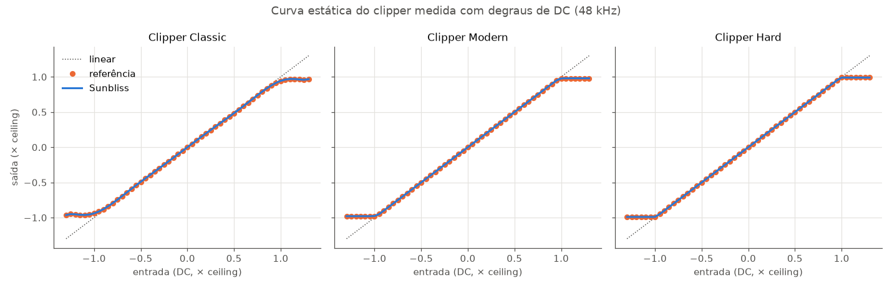

| Test | Criterion | Result |
|---|---|---|
| DC static curve, Clipper Modern / Classic / Hard | ≤ 0.5 dB | max 0.022 / **0.000** / 0.004 dB |
| 1 kHz sine −12…+8 dB, output RMS (Modern / Classic / Hard) | ≤ 0.5 dB | max 0.015 / 0.090 / 0.025 dB |
| Bliss Modern / Classic curves, amounts 1…6 | ≤ 0.5 dB | max 0.14 / 0.21 dB |
| Unity Gain (Modern / Classic, amount 6) | same effect | ref +0.03 / −0.004 dB, ours 0.000 dB |
| Sun 2 dB: static curve at 8 kHz and frequency curve | ≤ 0.5 dB | max 0.17 dB |
| Sun: static law (8 amounts × 30 levels) and frequency shape | — | max 0.005 / 0.03 dB |
| Sun: dynamics, carriers from 1.5 Hz to 1 kHz (mean gain / sidebands at 2f) | — | max 0.07 dB / ~1 dB (1.9 worst case) |
| Clip Filter (Modern / Classic / Hard), 100 Hz…20 kHz | ≤ 0.5 dB | max 0.035 / 0.075 / 0.035 dB |
| Box Tone Modern / Classic, 100 Hz…20 kHz | ≤ 0.5 dB | max 0.006 / 0.004 dB |

The DC curves are measured with soft-edged plateaus (2 ms). A hard edge makes the band-limited
path "ring", and that overshoot (with the limiter reacting to it) is not part of the static
curve. Before that change, the static error was 0.21 to 0.27 dB.

Loudness on the synthetic mix, with the same settings on both plugins (512 buffer):

| Setting | LUFS ref | LUFS ours | Δ | True-peak ref | True-peak ours (guard on) |
|---|---|---|---|---|---|
| Classic +6 | −13.03 | −13.08 | −0.05 | +1.14 | −0.15 |
| Modern +6 | −12.90 | −12.95 | −0.05 | +0.26 | −0.14 |
| Hard +6 | −12.96 | −12.96 | −0.01 | +0.34 | −0.14 |
| Hard +10 | −9.48 | −9.46 | +0.02 | +0.62 | −0.14 |
| Classic +6, Bliss Classic 3 | −10.45 | −10.46 | −0.01 | +0.56 | −0.14 |
| Modern +6, Bliss Modern 6 | −10.78 | −10.77 | +0.01 | +0.41 | −0.14 |
| Hard +6, Sun 2 | −12.99 | −13.02 | −0.03 | +0.23 | −0.14 |
| Classic +8, everything on | −8.30 | −8.32 | −0.02 | +1.15 | −0.14 |

With a 512 buffer the reference's ducking lasts ~5 ms, and the loudness of the two stays within
±0.05 LU. The up-to-+0.53 LU difference published earlier came from pedalboard's 8192 buffer.

### Where Sunbliss beats the reference

**Aliasing.** A clipped high tone generates harmonics above Nyquist which, left alone, "fold"
back into the audible range as frequencies that do not belong to the music:

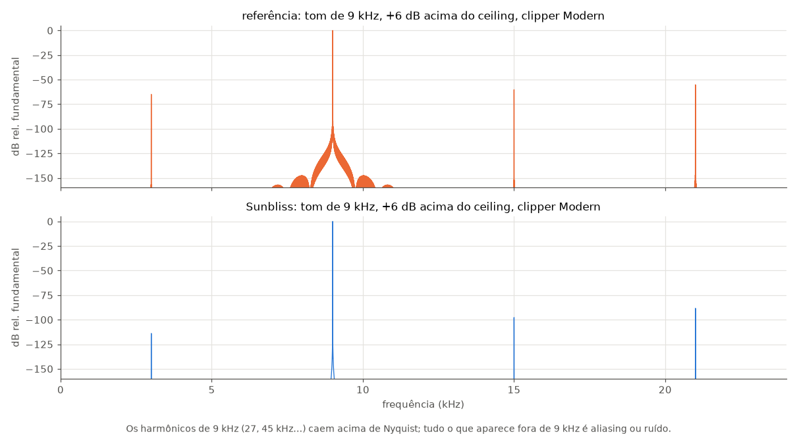

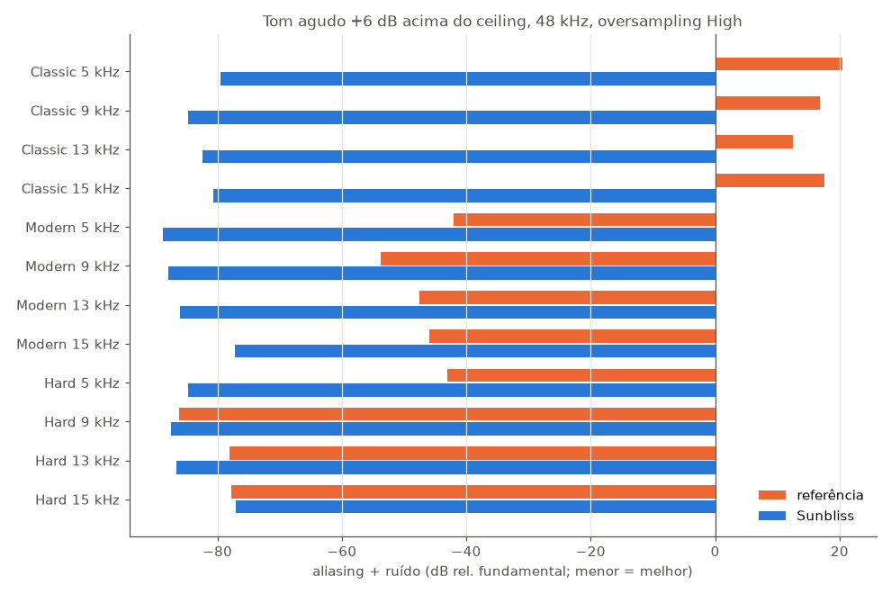

In Classic, the reference reaches **+12…+20 dB** because it diverges (inverts polarity) at
+6 dB on high tones.

| Metric | Reference | Sunbliss |
|---|---|---|
| Aliasing + noise, 12 cases (3 modes × 4 frequencies) | −86 … +20 dB | −77 … −89 dB (wins 11, ties 1) |
| Intermodulation 19+20 kHz, below 18 kHz (Modern / Classic / Hard) | −34.4 / −34.5 / **−37.9** dB | **−36.8 / −37.3** / −36.9 dB |
| True-peak on the mix, Classic +3 / +6 / +10 (guard on) | +0.21 / +1.14 / +0.74 dBTP | −0.15 / −0.15 / −0.14 dBTP |
| Residual below the ceiling (−6 dB), Modern and Hard | −94.5 dB | **−108.5 dB** |
| Everything neutral: peak residual | −40.8 dBFS | **bit-exact** |
| Recovery after a +12 dB burst (Hard / Classic), 512 buffer | 0.001 / 0.090 dB error | 0.006 / 0.094 dB (tie; with an 8192 buffer the reference is off by 2.04 / 0.80 dB) |
| Click when switching mode, curve, clip, tone or bypass (HF > 16 kHz within ±5 ms) | +0.01 … −2.6 dB | 0.00 … −2.5 dB (no HF excess in any of the 5 cases) |

### Oversampling modes (48 kHz)

Data from `lab/os_modes.py` (`docs/data/os_modes.json`), 512 buffer:

| Mode | Latency (samples) | Flat up to | Hard aliasing 9 / 13 / 15 kHz |
|---|---|---|---|
| Ref. High Linear | 764 | 20 kHz | −86 / −78 / −78 dB |
| Ref. High Minimum | 711 | 23 kHz | −97 / −81 / −95 dB |
| Ref. Pristine Linear | 769 | 20 kHz | −98 / −81 / −98 dB |
| **Sunbliss High Linear** | **328** | 20 kHz | −88 / −87 / −77 dB |
| **Sunbliss High Min Phase** | **250** | 22 kHz | −83 / −83 / −78 dB |
| **Sunbliss Pristine Linear** | 330 | 20 kHz | −91 / −94 / −91 dB |
| **Sunbliss Pristine Min Phase** | 251 | 22 kHz | −100 / −94 / −108 dB |

---

## Limitations and open items

- **CPU:** the lab measures **CPU cycles** of the render loop, read from the process's own
  counters (`lab/cpu_probe.py`). With a 512 buffer, Classic + Bliss 3 + Sun 1, the reference
  spends **113 Mcycles per second of audio** (ranging from 102 to 125: the counter includes
  PACE's security thread), and Sunbliss **68** (Pristine 110, Extra 195). The old wall-clock
  measurement, from a single 20 s render, reported "4.3 % against 2.7 %". It swung by tens of
  percent with the CPU frequency and the core type, and the result flipped once cycles were
  measured. Optimizations from 2026-10-18: decimator rejection from 140 down to 100 dB (no
  measured difference in aliasing, IMD or transparency), folded symmetric filters, contiguous
  half-band decimation, and Sun's crossover FIR at 1.2 ms.
- **High + Min Phase:** the reference has less aliasing in this mode (−97 against −83 dB at
  9 kHz). The components left in ours are discrete aliases (harmonics 19 to 23 of a 9 kHz tone
  folding at the 192 kHz rate, already attenuated by ADAA2). They do not come from the
  decimator (raising the precision of the minimum-phase transform changes nothing) nor from the
  limiter (switching it off changes nothing either). In linear mode we tie with the reference
  (−87.5 against −86.2 dB). Its minimum mode is a polyphase IIR half-band, according to the
  binary. Why that reduces the clip stage's aliases is still an open question. −83 dB is
  inaudible.
- **Hard clipper:** 19+20 kHz IMD and 15 kHz aliasing are up to 1 dB behind the reference.
- **Deliberate divergences:** we do not reproduce the ceiling's buffer-driven ducking, nor
  Classic's polarity inversion at extreme drive. The τ72 decay above 1.32 c and Sun's
  waveform-following modulation are reproduced as in the reference, because an analog stage near
  the clip point behaves that way too.
- **Unidentified polynomials:** the binary holds four more degree-15 polynomials that match no
  measured mode (Modern and Hard are not polynomials).
- **Validation in DAWs** (Ableton, Reaper, Logic) and a **blind test with real music** (F7)
  still depend on human listening. The kit is ready in `lab/abx.py`.
- The reference's **Extra Pristine + Minimum** state could not be recaptured: both attempts
  came out identical to High Minimum.

---

## Install (prebuilt binary)

Every tagged release is built by GitHub Actions
([`.github/workflows/release.yml`](.github/workflows/release.yml)) for three platforms, one zip
per format:

| Platform | Formats | Destination folder |
|---|---|---|
| **macOS, Apple Silicon** (`macos-arm64`) | AU v2 (`Sunbliss.component`) | `~/Library/Audio/Plug-Ins/Components` |
| | VST3 (`Sunbliss.vst3`) | `~/Library/Audio/Plug-Ins/VST3` |
| | CLAP (`Sunbliss.clap`) | `~/Library/Audio/Plug-Ins/CLAP` |
| **Windows x64** (`windows-x64`) | VST3 | `%COMMONPROGRAMFILES%\VST3` |
| | CLAP | `%COMMONPROGRAMFILES%\CLAP` |
| **Linux x64** (`linux-x64`) | VST3 | `~/.vst3` |
| | CLAP | `~/.clap` |

The file names follow `Sunbliss-<format>-<version>-<platform>.zip`, for example
`Sunbliss-au-v0.3.0-macos-arm64.zip`. `SHA256SUMS.txt` in the release has the hashes of every
zip. (The [v0.2.0](https://github.com/nagualcode/sunbliss/releases/tag/v0.2.0) release predates
CI and carries the macOS Apple Silicon zips only; v0.3.0 is the first to ship Windows and Linux.)

macOS:

```sh
unzip Sunbliss-au-v0.3.0-macos-arm64.zip -d ~/Library/Audio/Plug-Ins/Components
# the binary is only ad-hoc signed (no Developer ID, no notarization):
xattr -dr com.apple.quarantine ~/Library/Audio/Plug-Ins/Components/Sunbliss.component
auval -v aufx Snbl JSon   # should end in "AU VALIDATION SUCCEEDED"
```

Linux:

```sh
mkdir -p ~/.vst3 && unzip Sunbliss-vst3-v0.3.0-linux-x64.zip -d ~/.vst3
```

Windows: unzip into `C:\Program Files\Common Files\VST3` (or `...\CLAP`).

Reopen the DAW so it picks the plugin up. The x86_64 builds target `x86-64-v3` (AVX2, Haswell
2013 and newer); Intel Macs and older CPUs need a build from source (below).

## Build, install and reproduce

Requirements: Rust ≥ 1.92, `cargo-truce` 6.3, macOS (for AU/auval) and Python 3.11 for the lab.

```sh
make build        # cargo build --release (plugin + CLI)
make test         # DSP core tests
make install      # installs the AU v2 into ~/Library/Audio/Plug-Ins/Components (the lab uses the AU)
make validate     # auval -v aufx Snbl JSon
make bench        # CLI CPU per quality
```

Bundles for all formats, without installing (this is what CI does):

```sh
cargo truce build --clap --vst3 --au2 -p sunbliss   # -> target/bundles/
```

Lab (needs the reference plugin installed for the comparisons):

```sh
python3.11 -m venv .venv
.venv/bin/pip install pedalboard numpy scipy soundfile matplotlib pyloudnorm pymupdf pyyaml
make lab                                        # rebuilds and runs parity + superiority + report
cd lab && ../.venv/bin/python readme_figs.py    # the comparison figures in this README
cd lab && ../.venv/bin/python abx.py            # blind-test kit (music in refs/music/)
```

The CLI processes files without a DAW:

```sh
target/release/sunbliss-cli in.wav out.wav --set clip_mode=hard --set input=6   # Trim Link is on by default: the output compensates the 6 dB
```

---

## Repository layout

```
crates/core/     DSP core in f64 (no allocation on the audio thread)
  converter.rs     Classic/Modern/Hard clipper with ADAA2 and overload memory
  curves.rs        clipper and saturation curves (Bliss Classic = the Lavry equation)
  contour.rs       Sun (measured law, Linkwitz-Riley crossover, 0.4 ms smoothing)
  tone.rs          Box Tone (linear-phase FIR)
  oversampling.rs  linear-phase and minimum-phase oversampling
  guard.rs         output / true-peak limiter
  lavry.rs         Converter section: HPDF dither, NS1–NS4, word length, data limit
  engine.rs        the whole chain
crates/cli/      offline WAV/f64 processing
crates/plugin/   truce plugin (CLAP/VST3/AU), egui GUI, presets, loudness meter
lab/             black-box measurement, parity, superiority, ABX, figures
docs/            CHAIN, CONTROLS, TONE, REPORT, ENV + data (data/) and figures (fig/)
refs/            manuals, test tones and captured states (third-party material, study only)
```

Detailed technical documentation:
[`docs/CONTROLS.md`](docs/CONTROLS.md) (measured semantics of every parameter) ·
[`docs/CHAIN.md`](docs/CHAIN.md) (proofs of the chain order) ·
[`docs/TONE.md`](docs/TONE.md) (Box Tone) ·
[`docs/REPORT.md`](docs/REPORT.md) (report and generated tables) ·
[`docs/ENV.md`](docs/ENV.md) (environment and reference quirks).

Code license: MIT (declared in `Cargo.toml`). The material in `refs/` belongs to its respective
authors.
