# ☀️ Sunbliss

**Clipper e saturação de masterização no estilo "conversor A/D sobrecarregado", em Rust.**
Projeto de estudo: a engenharia reversa (por caixa-preta) do plugin **Gold Clip 1.5.0** e a
recriação, a partir do manual, da **Soft Saturation** e dos recursos de saída do conversor
**Lavry AD122-96 MkIII**.

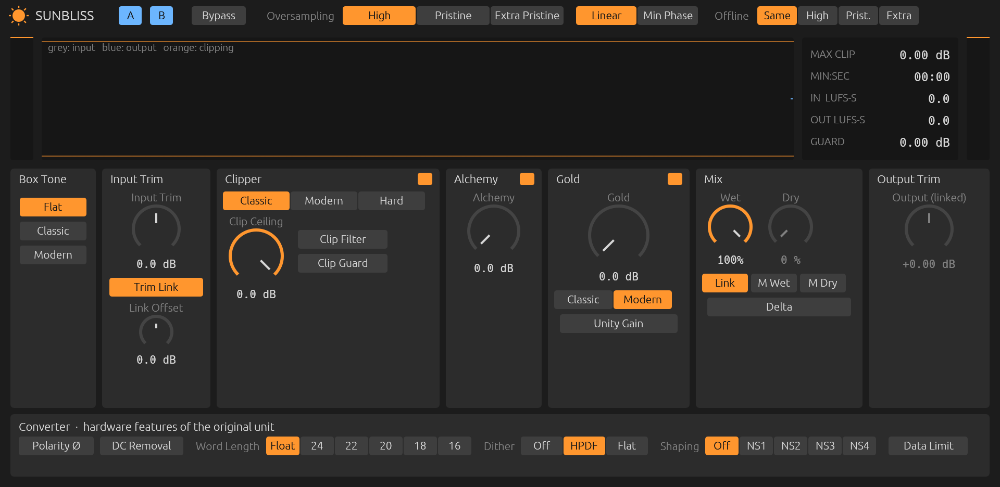

> **Aviso: uso educativo.** Este é um projeto pessoal, sem fins comerciais e sem afiliação com
> os fabricantes citados. Os binários do próprio Sunbliss são publicados nos
> [releases](https://github.com/nagualcode/sunbliss/releases), gratuitos e sem garantia. "Gold Clip" e "Lavry" são marcas dos
> respectivos donos e aparecem aqui só como referência técnica. Todos os números e curvas do
> Sunbliss foram deduzidos **medindo o áudio de saída** da referência e lendo os manuais
> públicos. Em 2026-10-17 houve também uma **leitura passiva do binário** da referência
> (textos embutidos, nomes de classes C++ e tabelas de constantes em texto puro), sem
> decifrar, depurar ou contornar a proteção (PACE) do plugin. Ela foi usada para orientar
> hipóteses e conferir resultados. Nada dela foi copiado para o código: cada valor do Sunbliss
> saiu de uma medição de caixa-preta que está em `lab/` (ver
> [Leitura white-box](#leitura-white-box-do-binário)).

---

## Sumário

1. [Resultados em uma tela](#resultados-em-uma-tela)
2. [Linhagem do som](#linhagem-do-som)
3. [Como foi a engenharia reversa](#como-foi-a-engenharia-reversa)
4. [A recriação da Lavry](#a-recriação-da-lavry)
5. [Cadeia de processamento](#cadeia-de-processamento)
6. [Guia dos controles](#guia-dos-controles)
7. [Métricas](#métricas)
8. [Limitações e pendências](#limitações-e-pendências)
9. [Instalar (binário pronto)](#instalar-binário-pronto) · [Compilar e reproduzir](#compilar-instalar-e-reproduzir)
10. [Estrutura do repositório](#estrutura-do-repositório)

---

## Resultados em uma tela

| | Referência (Gold Clip) | Sunbliss |
|---|---|---|
| Paridade de som (16 testes, critério ≤ 0,5 dB) | — | **16/16**, pior caso 0,21 dB |
| Curva Gold Classic × gráfico do manual Lavry | ≤ 0,21 dB do Sunbliss | **rms 0,03 dB** |
| Aliasing de tom agudo clipado (12 casos) | −86 a **+20** dB | **−77 a −89 dB** (vence 11/12) |
| True-peak na mixagem com o guard ligado | até **+1,14 dBTP** | **≤ −0,14 dBTP** |
| Resíduo com tudo neutro | −40,8 dBFS | **bit-transparente** |
| Latência (High, fase linear, 48 kHz) | 764 amostras (reporta 0 ao host) | **328** (reportada corretamente) |
| CPU, mesmo host, High, estéreo 48 kHz, buffer 512 (Mciclos por s de áudio) | 113 | **68** (−40 %) |
| Formatos | AU | CLAP · VST3 · AU v2 (auval OK) |

---

## Linhagem do som

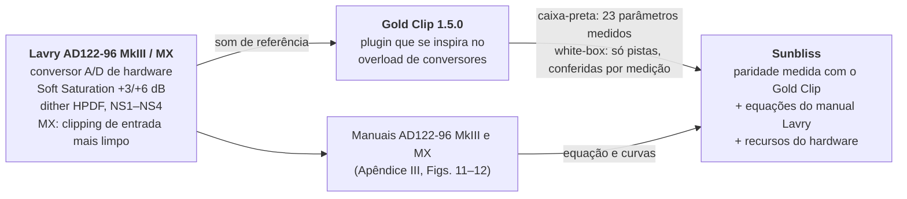

O som do Sunbliss tem duas origens:

1. **O Gold Clip, medido por fora.** Os controles, a ordem da cadeia, as curvas do clipper, as
   curvas Gold, o Alchemy e o Box Tone foram medidos no plugin e reproduzidos até ficarem a
   menos de 0,5 dB (na maioria dos casos, menos de 0,1 dB).
2. **O conversor Lavry, lido no manual.** O modo **Gold Classic** é a equação da Soft
   Saturation do Apêndice III do manual do AD122-96 MkIII. A seção **Converter** (polaridade,
   DC, word length, dither HPDF, noise shaping NS1–NS4, data limit) recria recursos do aparelho
   que o Gold Clip não tem.

Quando o Gold Clip e o hardware discordam, o projeto documenta a diferença e escolhe um lado.
Exemplo: o manual especifica THD+N de 0,0008 % a −6 dBFS, ou seja, o conversor real é
transparente abaixo do clip. A distorção de baixo nível do Clipper Classic do Gold Clip (~0,5 %
a −9 dBFS) é coloração do plugin. Mantivemos essa coloração no Classic (para paridade), e os
modos Modern e Hard ficaram fiéis ao hardware (THD < −170 dB abaixo do teto).

---

## Como foi a engenharia reversa

O trabalho seguiu oito fases (F0–F7), sempre com o mesmo princípio: **toda afirmação vira um
teste reprodutível em `lab/`**, e todo número deste README sai de `docs/data/*.json`.

### O banco de medição

- O Gold Clip (só existe em AU nesta máquina) é carregado **sem interface** pelo
  [pedalboard](https://github.com/spotify/pedalboard), em Python. O helper `lab/goldclip.py`
  liga e desliga parâmetros e renderiza qualquer sinal.
- Duas armadilhas apareceram logo na F0 e são compensadas em todo render:
  - **Latência escondida:** o plugin reporta latência 0 ao host, mas o pico da resposta ao
    impulso está em **764 amostras** (44,1/48 kHz) e **1394** (88,2/96 kHz).
  - **Aquecimento:** depois de um `reset()`, as primeiras ~10 mil amostras saem com a
    configuração anterior. Todo render leva 32768 amostras de silêncio na frente, que depois
    são descartadas.
  - **Buffer do host:** parte do comportamento da referência é decidida por buffer (ver o
    ducking abaixo). O pedalboard usa 8192 amostras por padrão, o que exagerava esse efeito
    nas fases F1–F6. Desde 2026-10-17 os dois plugins são medidos com **buffer de 512**, como
    num DAW típico.
- `lab/render.py` descreve cada ajuste uma vez, num vocabulário neutro, e o traduz para os dois
  plugins. Assim, referência e Sunbliss são sempre medidos na mesma grade.

### Os sinais de prova (`lab/stimuli.py`)

| Sinal | Para que serve |
|---|---|
| Degraus de DC de −1,3 a +1,3 × ceiling | Curva estática de cada clipper, sem efeito de filtro |
| Seno de 10 Hz quase em fundo de escala | Curva das saturações (memória < 1,5e−4, então é uma função da entrada) |
| Seno de 1 kHz de −12 a +12 dB | RMS, THD e inarmônicos por nível |
| Ruído a −40 dBFS + função de transferência H1 | Resposta em frequência linear (Box Tone, Clip Filter) |
| Tons de 5/9/13/15 kHz a +6 dB | Aliasing |
| Dois tons 19 + 20 kHz | Intermodulação |
| Rajadas de +12 dB seguidas de sinal de prova | Recuperação depois do clip |
| Mixagem sintética de 12 s (`music_synth.py`) | Loudness (LUFS) e true-peak em material parecido com música |

### O que descobrimos

| Descoberta | Como foi provada |
|---|---|
| **A ordem da cadeia é clipper → Alchemy → Gold**, e não saturação → clipper, como se supunha no início | A curva Gold normalizada pelo ceiling é idêntica a 0 e −6 dB (diferença 8e−5): ela opera sobre um sinal já limitado |
| O **Box Tone fica antes** do Input Trim e do clipper | O harmônico em 21 kHz de um tom de 7 kHz clipado não muda com o Tone (58,17 × 58,09 dB) |
| O **Clip Filter** é um passa-baixas de 1 polo em ~34 kHz, antes do clipper (aplicado duas vezes no modo Classic) | Harmônicos do clip iguais com e sem o filtro (Δ ≤ 0,01 dB); resposta idêntica a 48 e 96 kHz |
| O **Clipper Classic é um polinômio de grau 9**, assimétrico (H2 dominante já a −30 dBFS), válido até 1,32 c. Acima disso entra uma "memória de sobrecarga": a saída decai para zero com τ = 72,5 ms | 262 platôs DC: o ajuste de grau 9 deixa resíduo de 1,4e−7 (o piso do f32); graus 5 e 7 deixam 5e−2 e 3e−2. Degraus de 1,33 a 2,0 c decaem juntos, a cada 25 ms ×0,708 |
| Em drive extremo o Classic **diverge**: a partir de ~2,5 c o decaimento começa com a polaridade invertida | DC de 3,0 → −0,83, e tom agudo a +18 dB (figura abaixo). Tratado como defeito e **não** reproduzido |
| O **Clip Guard** quase não faz nada (−0,001 dB). Quem segura o pico é um *clamp* amostral mais um **ducking** escondido de até −2 dB, **decidido por buffer do host** | Degraus de DC de 2,0 e 4,0 geram −1 e −2 dB. A duração acompanha o buffer: 230 ms com 8192, 60 ms com 2048, 5 ms com 512, nada com 128 |
| O **true-peak escapa** até +1,04 dB acima do ceiling | Medição com oversampling 8× |
| O **Alchemy** divide a banda com um Linkwitz-Riley de fase linear em 2965 Hz e reduz a banda alta conforme o nível \|x\|/c, quase instantâneo: segue a forma de onda de um grave (bandas laterais de AM), mas alisa a de um agudo (média cúbica, τ 0,4 ms) | Sonda de 8 kHz sobre platôs DC (lei estática), portadoras de 1,5 Hz a 1 kHz com sonda em 15 kHz (dinâmica) |
| A curva **Gold Modern** é linear até 0,5 c e depois uma quadrática C1 até (c, c). Daí o máximo "natural" de +2,5 dB | Ajuste com erro ≤ 0,06 dB (`docs/data/fit_modern_hermite.json`) |
| O **Delta** do Gold Clip inclui o ganho do Input Trim, e o **Trim Link** só funciona na GUI (a automação não o enxerga) | Null tests |

Curvas da referência obtidas nessa fase:

| Clipper (DC) e curvas Gold | Formas de onda clipadas (repare no Classic a +18 dB em 1 kHz) |
|---|---|
| 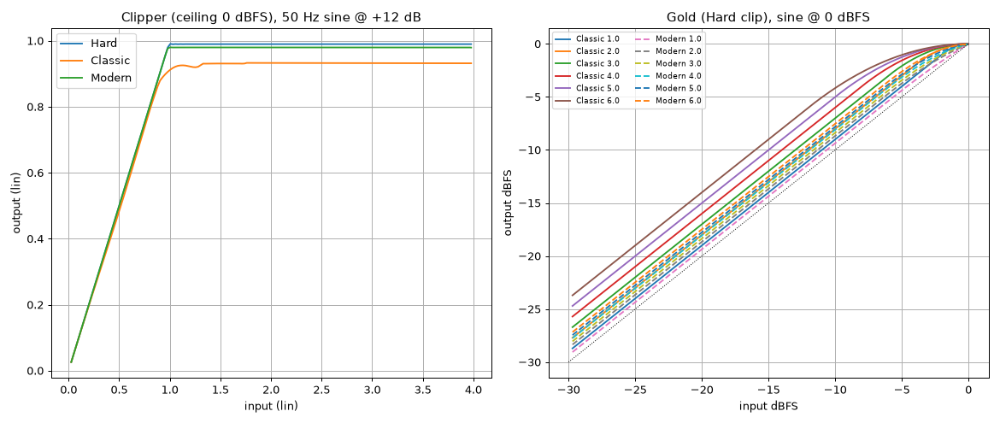 | 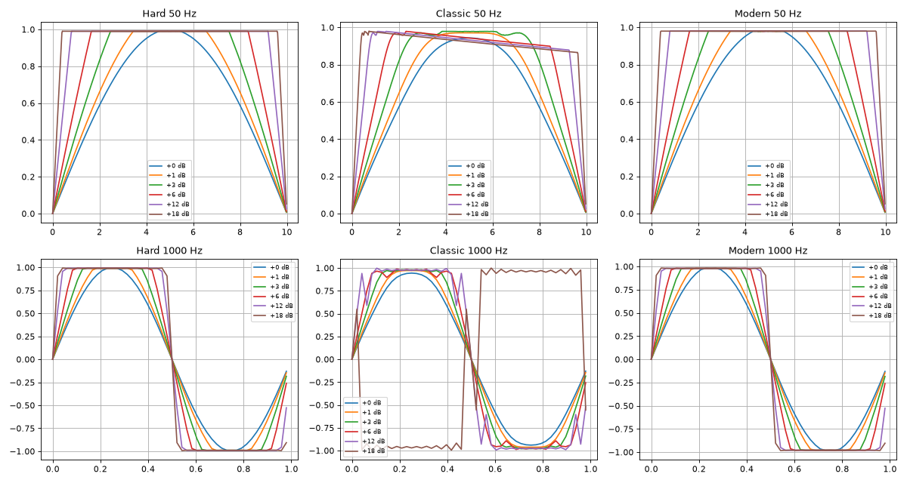 |

| Ganho das curvas Gold por amount | Resposta linear da referência (Box Tone, Clip Filter) |
|---|---|
| 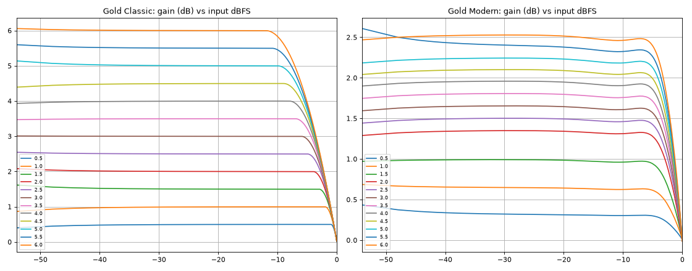 | 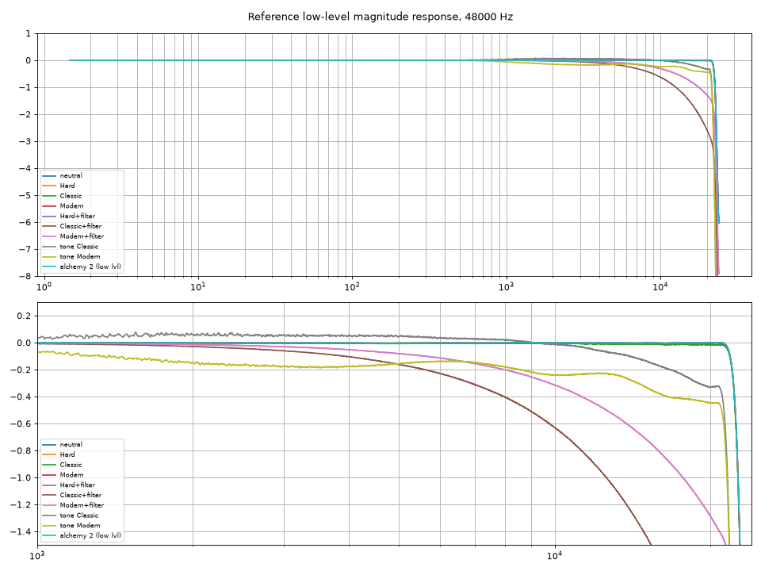 |

O ganho do Alchemy, medido num tom de 8 kHz enquanto um grave bate no teto. A modulação segue
a forma de onda do grave amostra a amostra:

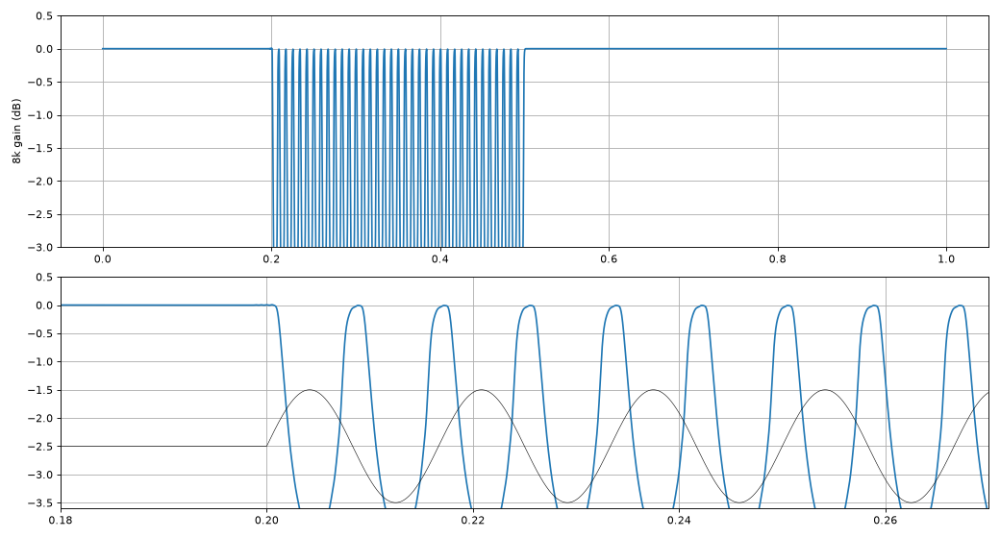

### Estados ocultos

O oversampling (High/Pristine/Extra Pristine) e o tipo de fase (Linear/Minimum) do Gold Clip
**não são parâmetros**: ficam num blob de estado ofuscado (cabeçalho `KLBW`). Não tentamos
decifrá-lo. Em vez disso, `lab/capture_gc_states.py` grava o estado depois de cada escolha
feita na própria GUI do plugin, e esses estados opacos são reaplicados antes de medir
(`refs/goldclip_states/`).

### As fases

| Fase | Entrega |
|---|---|
| F0 Ambiente | Toolchain Rust/truce, pedalboard, latência e aquecimento da referência |
| F1 Inventário | 23 parâmetros mapeados (`docs/goldclip_params.json`, `docs/CONTROLS.md`), cadeia confirmada (`docs/CHAIN.md`) |
| F2 Laboratório | Estímulos, métricas, render comparativo, baseline da referência em `docs/data/gc_*.json` |
| F3 Núcleo DSP | `crates/core` em f64, sem alocação no áudio: oversampling, clipper com ADAA, curvas, guard |
| F4 Blocos restantes | Alchemy, Box Tone (`docs/TONE.md`), mixer/delta, unity, suíte de paridade |
| F5 Plugin | CLAP/VST3/AU com [truce](https://crates.io/crates/truce), GUI, presets, A/B, medidores |
| F6 Superioridade | Suíte que mede onde o Sunbliss melhora a referência |
| F7 Teste cego | Kit ABX com pares nivelados em loudness (`lab/abx.py`), aguardando audição com música real |
| F8 White-box | Leitura passiva do binário da referência, lab com buffer de 512, Classic polinomial, Alchemy com a dinâmica da referência (seção abaixo) |

### Leitura white-box do binário

Em 2026-10-17 o binário do Gold Clip 1.5.0 foi lido **sem execução e sem decifrar nada**: o
código principal é protegido por PACE (Fusion/Eden), e isso foi respeitado. Só foram
inspecionados textos embutidos, nomes de classes C++ (RTTI) e tabelas de constantes em texto
puro. O que apareceu, e como cada pista foi usada:

| Pista no binário | O que mudou no projeto |
|---|---|
| Feito em JUCE 7 + chowdsp_utils. Os processadores se chamam `BoxToneProcessor`, `ClipperProcessor`, `MXProcessor` (Alchemy, parâmetros `mx_amount`/`mx_on_off`), `SoftSaturationProcessor` (Gold), `DryWetProcessor` | Confirma a cadeia deduzida na F1. O nome "MX" liga o Alchemy ao **AD122-96 MX**, cujo manual (agora em `refs/manual/`) diz que o MX só muda o clipping analógico de entrada, com o mesmo software do MkIII |
| Clipper com `PolynomialWaveshaper<9>` e `<15>`, `HardClipper` e `chowdsp::ADAAWaveshaper` (ADAA de 2ª ordem por tabela) | Hipótese "o Classic é um polinômio". **Testada por caixa-preta**: 262 platôs DC dão resíduo de 1,4e−7 com grau 9 (`lab/fit_classic.py`). O Classic do Sunbliss usa esse ajuste próprio. Os coeficientes embutidos serviram só para conferir: diferença ≤ 2,7e−4 |
| Uma cópia modificada da classe de oversampling do JUCE, `OversamplingWithCeiling`, com o código-fonte embutido em texto. Depois da decimação ela mede o pico amostral do **buffer**, aplica ganho `ceiling/pico` em rampa e mantém o mínimo de dois buffers | O "ducking com hold de 0,4 s" era o buffer de 8192 do pedalboard. **Confirmado por caixa-preta** (230 / 60 / 5 / 0 ms com 8192 / 2048 / 512 / 128) e o lab passou a usar buffer de 512 |
| Oversampling: meia-banda FIR equiripple (Linear) e meia-banda **IIR polifásica allpass** (Minimum), com as especificações do JUCE | Explica o plano até 20 kHz e o aliasing de 20–24 kHz. Estudado para o nosso modo Min Phase (ver pendências) |
| `LinearPhaseCrossover` com protótipo SVF passa-baixas no `MXProcessor` | Hipótese "o Alchemy divide a banda com um filtro de 2ª ordem de fase linear". **Medido**: a banda baixa é 1/(1+(f/2965 Hz)⁴), com erro de 0,0024 |
| `chowdsp::LinearPhaseEQ<PeakingFilter>` no Box Tone | Confirma "EQ linear de fase linear". Nosso FIR já fica a ≤ 0,006 dB, então não foi reparametrizado |

---

## A recriação da Lavry

### Soft Saturation (Apêndice III do manual)

O manual descreve dois ajustes, **+3 dB** e **+6 dB**: ganho linear até um limiar (−6 dBFS de
entrada no +3, −12 dBFS no +6) e, acima dele, uma curva **exponencial** cuja inclinação casa
exatamente com a da parte linear ("slopes precisely equal to 22 bit accuracy"). O texto não
traz a equação, só o gráfico.

Generalizamos para um knob contínuo **G** (0 a 6 dB), com ganho `g = 10^(G/20)` e limiar
`T = 10^(−2G/20)`:

```
        ⎧ g·|u|                                   se |u| ≤ T
|y| =   ⎨
        ⎩ g·T + A·(1 − e^(−g·(|u| − T)/A))         se |u| > T
```

- A curva é C1 no limiar (as derivadas dos dois lados valem `g`), como pede o manual.
- `A` é resolvido numericamente para que **fundo de escala saia em fundo de escala**:
  y(1) = 1 (fechamento "b").
- Digitalizamos o gráfico do manual (222 pontos no +3, 306 no +6) e testamos três
  fechamentos. O (b) explica o gráfico com **rms 0,031 dB (+3) e 0,033 dB (+6)**. O fechamento
  (a), assintótico, prevê −0,22 dB em 0 dBFS, o que contradiz o gráfico e a lâmpada MAX
  ("indicates that the signal has reached full scale").
- A curva Classic do Gold Clip fica a ≤ 0,21 dB dessa equação. Ou seja, o Gold Classic **é** a
  Soft Saturation da Lavry.

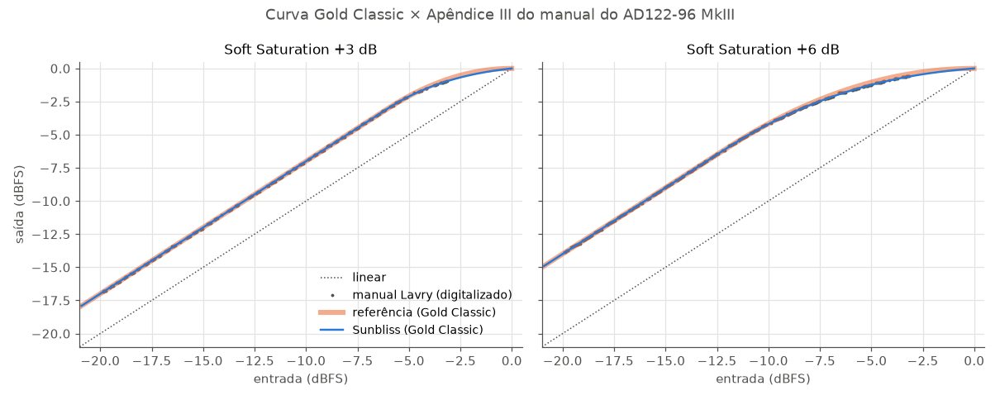

| Página do manual (Apêndice III) | Página do manual (gráfico digitalizado) |
|---|---|
| 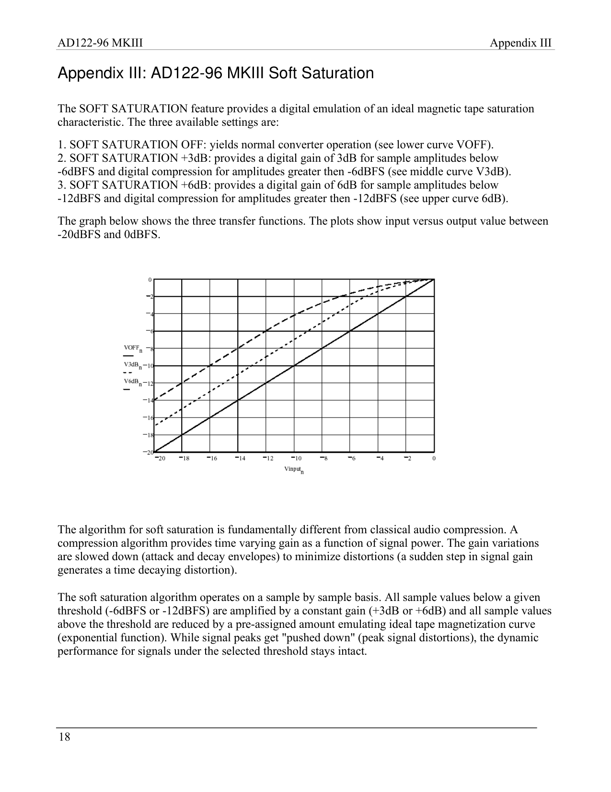 | 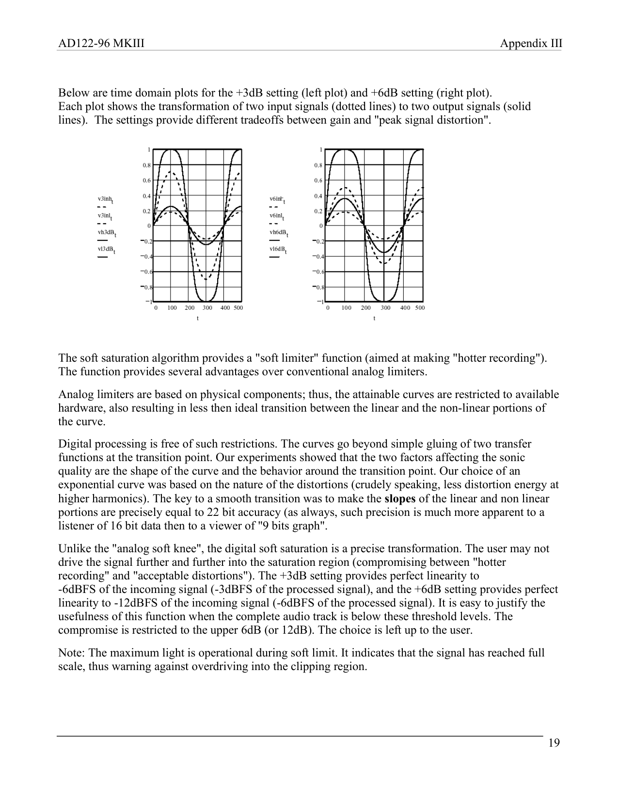 |

### A seção Converter

O Gold Clip não modela o estágio de saída do conversor. O Sunbliss recria esses recursos a
partir da Parte I e do Apêndice I do manual (`crates/core/src/lavry.rs`):

- **Dither HPDF**, o "triangle high pass" do manual: um número aleatório uniforme novo menos o
  anterior. Isso dá ruído triangular (TPDF) com espectro inclinado para os agudos.
- **Noise shaping NS1–NS4**: realimentação de erro de 24ª ordem, fase mínima, com as curvas
  traçadas das Figs. 11–12 (vales em ~4 kHz e ~12 kHz, ruído empurrado acima de 14 kHz).
  Medição a 44,1 kHz/16 bit, relativa ao HPDF sem shaping:

| | 1 kHz | 4 kHz | 8 kHz | 12 kHz | 16 kHz | 20 kHz | ruído total |
|---|---|---|---|---|---|---|---|
| NS1 | −2,7 | −4,6 | −2,9 | −4,0 | +2,8 | +6,4 | −93,5 dBFS |
| NS2 | −6,3 | −9,6 | −4,7 | −6,4 | +6,8 | +11,6 | −88,5 dBFS |
| NS3 | −7,7 | −12,1 | −6,1 | −11,4 | +10,2 | +19,8 | −81,6 dBFS |
| NS4 | −9,6 | −20,8 | −10,5 | −10,1 | +14,2 | +29,4 | −72,6 dBFS |

Os alvos vêm de um gráfico impresso: a forma é fiel, mas os coeficientes originais não são
públicos.

---

## Cadeia de processamento

```mermaid
flowchart LR
    IN([entrada]) --> PRE[Converter, entrada<br/>Polarity Ø, DC Removal] --> TONE[Box Tone<br/>FIR fase linear] --> TRIM[Input Trim] --> UP["↑ oversampling<br/>4/8/16×"]
    UP --> CF[Clip Filter<br/>opcional] --> CLIP[Clipper<br/>Classic/Modern/Hard<br/>ADAA 2ª ordem] --> ALC[Alchemy] --> GOLD[Gold] --> DOWN["↓ decimação<br/>sem aliasing"]
    DOWN --> LIM[Limitador de saída<br/>pico / true-peak] --> UNITY[Unity Gain] --> MIX{Mix<br/>Wet/Dry/Delta}
    PRE -. "dry (atrasado pela latência)" .-> MIX
    MIX --> OUT[Output Trim] --> CONV[Converter, saída<br/>word length, dither,<br/>shaping, data limit] --> BYP[Bypass<br/>crossfade] --> Y([saída])
```

- Todo o processamento não linear roda na taxa com oversampling.
- O clipper usa **ADAA de 2ª ordem** (anti-aliasing por antiderivada) sobre curvas tabeladas.
  Num tom de 9 kHz clipado a 4×, dá −82 dB de aliasing, contra −64 dB do ADAA de 1ª ordem.
- O Alchemy divide a banda em 2965 Hz (Linkwitz-Riley de fase linear, num FIR interpolado) e
  aplica a lei de ganho da referência na taxa de oversampling, sem detector separado nem
  lookahead.
- O decimador rejeita **tudo a partir de fs/2** (100 dB). O da referência é meia-banda e deixa
  passar aliasing na faixa de 20–24 kHz.
- O limitador de saída tem lookahead fixo de ~1,8 ms, então a latência não muda ao ligar o
  Clip Guard. O dry é atrasado junto.
- Detalhes e provas: [`docs/CHAIN.md`](docs/CHAIN.md).

---

## Guia dos controles

Os nomes, a ordem das opções e os valores padrão **espelham os do Gold Clip**, então um ajuste
pode ser copiado de um plugin para o outro. Nos controles que funcionam diferente, a GUI mostra
um tooltip explicando a diferença (marcados com **≠** abaixo).

### Barra superior

| Controle | O que faz |
|---|---|
| **A / B** | Duas memórias de ajuste. Clique alterna entre elas; Alt-clique copia o ajuste atual para a outra. Ficam salvas na sessão do DAW. |
| **Bypass** | Desliga o processamento com crossfade (sem clique). A saída fica alinhada à latência, então ligar e desligar não desloca o áudio. |
| **Oversampling: High / Pristine / Extra Pristine** | Quanto o sinal é ampliado em taxa antes das não linearidades: 4×, 8× e 16× a 44,1/48 kHz (metade disso a 88,2/96 kHz). Mais oversampling = menos aliasing e mais CPU. |
| **Linear / Min Phase** | Tipo dos filtros de oversampling. *Linear*: sem rotação de fase, mais latência, com pré-ringing simétrico. *Min Phase*: menos latência (250 contra 328 amostras), sem pré-ringing, com uma leve rotação de fase perto dos agudos. |
| **Offline: Same / High / Prist. / Extra** | Usa outra qualidade só no render/bounce offline (por exemplo, High ao mixar e Extra no export). *Same* = a mesma do tempo real. |

### Medidores

| Medidor | O que mostra |
|---|---|
| **Forma de onda** | Cinza = entrada, azul = saída, laranja = onde houve clipping. |
| **MAX CLIP** | O maior clipping desde o último reset, em dB acima do ceiling (medido na entrada do clipper). |
| **MIN:SEC** | Em que ponto da timeline do DAW esse máximo aconteceu. Duplo clique zera os dois. |
| **IN / OUT LUFS-S** | Loudness de curto prazo (3 s) na entrada e na saída, para comparar com níveis iguais. |
| **GUARD** | Quanto o limitador de saída ou o Clip Guard está reduzindo, em dB. |

### Box Tone

Coloração linear (só EQ, sem distorção), aplicada **antes** do clipper. Fica entre décimos de dB
e só atua acima de ~400 Hz.

| Opção | Som |
|---|---|
| **Flat** | Nada. É bit-transparente (na referência, o caminho neutro não é). |
| **Classic** | Brilho de +0,03 a +0,06 dB entre 1 e 6 kHz e queda suave acima de 10 kHz. |
| **Modern** | Depressão de 0,2 dB entre 2 e 10 kHz e queda até −0,45 dB em 18 kHz. |

A troca de opção faz crossfade de 10 ms. Medições em [`docs/TONE.md`](docs/TONE.md).

### Input Trim

| Controle | O que faz |
|---|---|
| **Input Trim** (−12…+12 dB) | Ganho antes do clipper. É o "drive": quanto mais alto, mais o sinal passa do Clip Ceiling e mais é clipado. |
| **Trim Link** ≠ | Liga o Output Trim ao Input Trim de forma inversa: subir 3 dB na entrada baixa 3 dB na saída. Assim você ouve o efeito do clip sem a ilusão de "mais alto = melhor". *Diferença:* no Sunbliss o link vale também para automação e para o host. No Gold Clip ele só funciona pela GUI. |
| **Link Offset** (−12…+12 dB) | Com o link ligado, soma um ganho fixo à saída: Output = −Input + Offset. |

### Clipper

| Controle | O que faz |
|---|---|
| **Liga/desliga** (quadrado laranja) | Ativa o clipper. Desligado, o Gold ignora o ceiling e trabalha em relação a 0 dBFS, como na referência. |
| **Classic** ≠ | O modelo de conversor "à moda antiga": compressão suave e **assimétrica** desde níveis baixos (2º harmônico, som mais quente), seguindo o polinômio de grau 9 medido na referência. Acima de 1,32 do teto, o platô **afunda** enquanto a sobrecarga dura (τ = 72,5 ms), o que dá corpo aos graves. *Diferença:* não reproduz a inversão de polaridade da referência em drive extremo (a partir de ~2,5× o teto). |
| **Modern** | Linear até ~90 % do teto, com um joelho curto até 0,98 do ceiling. Limpo abaixo do teto e um pouco mais macio que o Hard. |
| **Hard** | Linear até o teto e corte reto. O mais transparente até o ponto de clip e o mais "duro" depois dele. |
| **Clip Ceiling** (−36…0 dB) ≠ | O teto do clipper. O Alchemy e o Gold usam esse mesmo teto como referência. *Diferença:* o Sunbliss não faz o "ducking" escondido de até −2 dB que a referência aplica depois de ataques fortes. Lá ele é decidido por buffer do host e dura dois buffers (~5 ms com 512, ~0,2 s com 8192). Aqui o pico é segurado por um limitador suave que não depende do buffer. |
| **Clip Filter** | Passa-baixas suave (1 polo, ~34 kHz) antes do clipper. Arredonda transientes ultrassônicos e deixa o clip um pouco menos áspero. No modo Classic o efeito é dobrado (−2,6 dB em 20 kHz). |
| **Clip Guard** ≠ | Garante que o **true-peak** (o pico real depois da conversão D/A) fique 0,15 dB abaixo do ceiling. *Diferença:* na referência este botão quase não muda nada e o true-peak passa até +1 dB do teto. Com o guard desligado, o Sunbliss segura os picos *amostrais* no teto. |

### Alchemy

| Controle | O que faz |
|---|---|
| **Liga/desliga** | Ativa o Alchemy. |
| **Alchemy** (0…2 dB) | Suaviza os agudos **só quando o sinal chega perto do teto**: a banda acima de ~3 kHz (crossover de 2965 Hz) desce até −4 dB com 2 dB de amount. Doma a aspereza que o clip cria nos picos sem escurecer o resto da música. Como na referência, o ganho segue a forma de onda dos graves: um bumbo que bate no teto "respira" nos pratos (bandas laterais de AM). Em sinais agudos ele é alisado (τ 0,4 ms), então não distorce o próprio agudo. A lei, o crossover e a dinâmica foram medidos na referência e batem em até 0,07 dB. |

### Gold

| Controle | O que faz |
|---|---|
| **Liga/desliga** | Ativa a saturação. |
| **Gold** (0…6 dB) | Saturação suave **depois** do clipper. Acrescenta ganho nos níveis baixos e médios e arredonda a chegada ao teto: a música fica mais densa e mais alta sem passar do ceiling. |
| **Classic** ≠ | A Soft Saturation do manual da Lavry: ganho exato de G dB abaixo de −2G dBFS e uma curva exponencial até o teto. Com 6 dB, ganho total até −12 dBFS. É a mais forte e "encorpada". |
| **Modern** | Curva mais contida: linear até a metade do teto e uma transição parabólica até ele. O ganho máximo é +2,5 dB (o knob em 6 vale ~2,5 dB de ganho real). Mais transparente que o Classic. |
| **Unity Gain** | Compensa o ganho do Gold na saída (Classic 6 → −6 dB, Modern 6 → −2,5 dB). Serve para comparar com e sem saturação no mesmo volume. |

### Mix

| Controle | O que faz |
|---|---|
| **Wet** (0…100 %) | Nível do sinal processado, em amplitude linear (50 % = −6 dB). |
| **Dry** (0…100 %) | Nível do sinal original, atrasado pela latência para somar em fase. Permite clip "em paralelo". |
| **Link** | Mantém Dry = 100 − Wet (um único controle de mistura). |
| **M Wet / M Dry** | Silencia o wet ou o dry sem perder os ajustes. |
| **Delta** ≠ | Toca só a **diferença** entre o processado e o original: você ouve exatamente o que o plugin está tirando ou acrescentando. *Diferença:* o Sunbliss desconta o Input Trim, então o delta mostra só o processamento, e não o ganho do trim. |

### Output Trim

| Controle | O que faz |
|---|---|
| **Output Trim** (−12…+12 dB) | Ganho final, depois do mix (afeta wet e dry). Com o Trim Link ligado, o rótulo vira "Output (linked)" e o valor é calculado automaticamente. |

### Converter: recursos do hardware original

Polarity Ø e DC Removal atuam na entrada (antes do dry, para o paralelo continuar coerente). Word Length, Dither, Shaping e Data Limit atuam por último, na saída, como no aparelho. Nenhum deles existe no Gold Clip.

| Controle | O que faz |
|---|---|
| **Polarity Ø** | Inverte a polaridade (digital, com crossfade passando por zero). |
| **DC Removal** | Remove DC com um passa-altas de 0,3 Hz, que assenta em < 3 s, como o DC REMOVAL do hardware. Atua antes do clipper, então DC não desloca o clip. |
| **Word Length: Float / 24 / 22 / 20 / 18 / 16** | Profundidade de bits da saída. *Float* não reduz nada. As outras opções quantizam para entregar, por exemplo, um master de 16 bit para CD. |
| **Dither: Off / HPDF / Flat** | Ruído que torna a quantização linear (sem distorção de baixo nível). *HPDF* é o "triangle high pass" da Lavry, a preferência do manual. *Flat* é TPDF plano, recomendado no manual para destinos com compressão de dados. Só atua quando o Word Length não é Float. |
| **Shaping: Off / NS1–NS4** | Empurra o ruído do dither para frequências onde o ouvido é menos sensível (acima de 14 kHz), baixando-o em ~4 kHz e ~12 kHz. NS1 é o mais suave, NS4 o mais agressivo. Desliga sozinho com o Dither em Off, como no hardware. |
| **Data Limit** | Limita o fundo de escala a 1 LSB abaixo do máximo, para nenhum medidor ou aparelho seguinte acusar "over". |

### Presets de fábrica

| Preset | Ideia |
|---|---|
| Gentle Converter | Um toque de overload de conversor e Gold Modern, com true-peak seguro |
| Loud and Clean | Clip Hard com oversampling Pristine e Alchemy domando os agudos nos picos |
| Peak Shaver | Transparente: só os picos mais altos tocam o clipper |
| Drum Bus Snap | Clip Modern em paralelo, com Gold Classic forte por baixo do dry |
| Tape Bloom | Gold Classic (a Soft Saturation da Lavry) bem puxado, com Box Tone Classic |

---

## Métricas

Todas as medições são a **48 kHz, oversampling High, fase linear**, salvo indicação. Os dados
brutos estão em [`docs/data/parity.json`](docs/data/parity.json) e
[`docs/data/superiority.json`](docs/data/superiority.json). O relatório completo está em
[`docs/REPORT.md`](docs/REPORT.md).

### Paridade com a referência

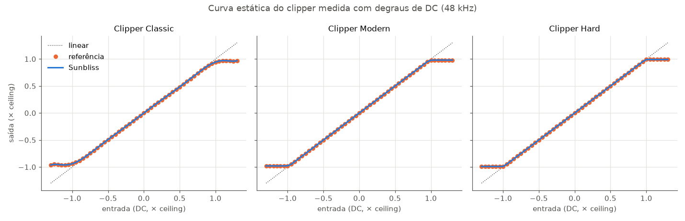

| Teste | Critério | Resultado |
|---|---|---|
| Curva estática DC, Clipper Modern / Classic / Hard | ≤ 0,5 dB | máx 0,022 / **0,000** / 0,004 dB |
| Seno 1 kHz −12…+8 dB, RMS de saída (Modern / Classic / Hard) | ≤ 0,5 dB | máx 0,015 / 0,090 / 0,025 dB |
| Curvas Gold Modern / Classic, amounts 1…6 | ≤ 0,5 dB | máx 0,14 / 0,21 dB |
| Unity Gain (Modern / Classic, amount 6) | mesmo efeito | ref +0,03 / −0,004 dB, nosso 0,000 dB |
| Alchemy 2 dB: curva estática a 8 kHz e curva de frequência | ≤ 0,5 dB | máx 0,17 dB |
| Alchemy: lei estática (8 amounts × 30 níveis) e forma em frequência | — | máx 0,005 / 0,03 dB |
| Alchemy: dinâmica, portadoras de 1,5 Hz a 1 kHz (ganho médio / bandas laterais em 2f) | — | máx 0,07 dB / ~1 dB (1,9 no pior caso) |
| Clip Filter (Modern / Classic / Hard), 100 Hz…20 kHz | ≤ 0,5 dB | máx 0,035 / 0,075 / 0,035 dB |
| Box Tone Modern / Classic, 100 Hz…20 kHz | ≤ 0,5 dB | máx 0,006 / 0,004 dB |

As curvas DC são medidas com platôs de bordas suaves (2 ms). Uma borda dura faz o caminho
limitado em banda "tocar", e esse overshoot (com o limitador reagindo a ele) não faz parte da
curva estática. Antes disso, o erro estático era de 0,21 a 0,27 dB.

Loudness na mixagem sintética, com os mesmos ajustes nos dois plugins (buffer de 512):

| Ajuste | LUFS ref | LUFS nosso | Δ | True-peak ref | True-peak nosso (guard on) |
|---|---|---|---|---|---|
| Classic +6 | −13,03 | −13,08 | −0,05 | +1,14 | −0,15 |
| Modern +6 | −12,90 | −12,95 | −0,05 | +0,26 | −0,14 |
| Hard +6 | −12,96 | −12,96 | −0,01 | +0,34 | −0,14 |
| Hard +10 | −9,48 | −9,46 | +0,02 | +0,62 | −0,14 |
| Classic +6, Gold Classic 3 | −10,45 | −10,46 | −0,01 | +0,56 | −0,14 |
| Modern +6, Gold Modern 6 | −10,78 | −10,77 | +0,01 | +0,41 | −0,14 |
| Hard +6, Alchemy 2 | −12,99 | −13,02 | −0,03 | +0,23 | −0,14 |
| Classic +8, tudo ligado | −8,30 | −8,32 | −0,02 | +1,15 | −0,14 |

Com buffer de 512 o ducking da referência dura ~5 ms, e o loudness dos dois fica a ±0,05 LU.
A diferença de até +0,53 LU publicada antes vinha do buffer de 8192 do pedalboard.

### Onde o Sunbliss melhora a referência

**Aliasing.** Um tom agudo clipado gera harmônicos acima de Nyquist que, sem cuidado, "dobram"
de volta para a faixa audível como frequências que não pertencem à música:

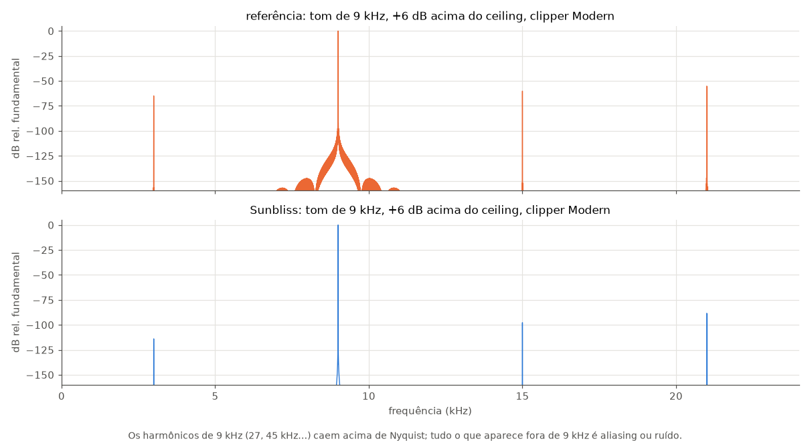

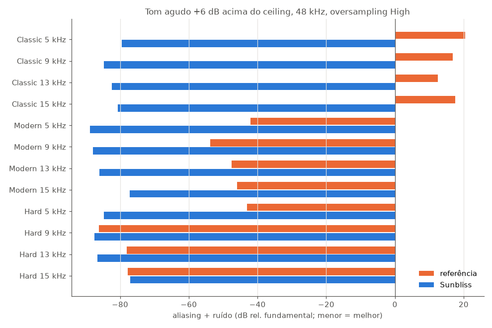

No Classic, a referência chega a **+12…+20 dB** porque diverge (inverte a polaridade) a +6 dB
em tons agudos.

| Métrica | Referência | Sunbliss |
|---|---|---|
| Aliasing + ruído, 12 casos (3 modos × 4 frequências) | −86 … +20 dB | −77 … −89 dB (vence 11, empata 1) |
| Intermodulação 19+20 kHz, abaixo de 18 kHz (Modern / Classic / Hard) | −34,4 / −34,5 / **−37,9** dB | **−36,8 / −37,3** / −36,9 dB |
| True-peak na mixagem, Classic +3 / +6 / +10 (guard on) | +0,21 / +1,14 / +0,74 dBTP | −0,15 / −0,15 / −0,14 dBTP |
| Resíduo abaixo do teto (−6 dB), Modern e Hard | −94,5 dB | **−108,5 dB** |
| Tudo neutro: resíduo de pico | −40,8 dBFS | **bit-exato** |
| Recuperação depois de rajada de +12 dB (Hard / Classic), buffer 512 | erro de 0,001 / 0,090 dB | 0,006 / 0,094 dB (empate; com buffer de 8192 a referência erra 2,04 / 0,80 dB) |
| Clique ao trocar de modo, curva, clip, tone ou bypass (HF > 16 kHz em ±5 ms) | +0,01 … −2,6 dB | 0,00 … −2,5 dB (nenhum excesso de HF nos 5 casos) |

### Modos de oversampling (48 kHz)

Dados de `lab/os_modes.py` (`docs/data/os_modes.json`), buffer de 512:

| Modo | Latência (amostras) | Plano até | Aliasing Hard 9 / 13 / 15 kHz |
|---|---|---|---|
| Ref. High Linear | 764 | 20 kHz | −86 / −78 / −78 dB |
| Ref. High Minimum | 711 | 23 kHz | −97 / −81 / −95 dB |
| Ref. Pristine Linear | 769 | 20 kHz | −98 / −81 / −98 dB |
| **Sunbliss High Linear** | **328** | 20 kHz | −88 / −87 / −77 dB |
| **Sunbliss High Min Phase** | **250** | 22 kHz | −83 / −83 / −78 dB |
| **Sunbliss Pristine Linear** | 330 | 20 kHz | −91 / −94 / −91 dB |
| **Sunbliss Pristine Min Phase** | 251 | 22 kHz | −100 / −94 / −108 dB |

---

## Limitações e pendências

- **CPU:** o lab mede **ciclos de CPU** do laço de render, lidos dos contadores do próprio
  processo (`lab/cpu_probe.py`). Com buffer de 512, Classic + Gold 3 + Alchemy 1, a
  referência gasta **113 Mciclos por segundo de áudio** (oscila de 102 a 125: o contador
  inclui a thread de segurança do PACE), e o Sunbliss **68** (Pristine 110, Extra 195). A
  medição antiga por tempo de relógio, com um único render de 20 s, dava "4,3 % contra 2,7 %".
  Ela oscilava dezenas de por cento com a frequência do processador e com o tipo de núcleo, e
  o resultado se inverteu ao medir ciclos. Otimizações de 2026-10-18: rejeição do decimador
  de 140 para 100 dB (sem diferença medida de aliasing, IMD ou transparência), filtros
  simétricos dobrados, decimação meia-banda contígua e o FIR do crossover do Alchemy com
  1,2 ms.
- **High + Min Phase:** a referência tem menos aliasing nesse modo (−97 contra −83 dB a 9 kHz).
  Os componentes que sobram em nós são aliases discretos (harmônicos 19 a 23 de um tom de
  9 kHz dobrando na taxa de 192 kHz, já atenuados pelo ADAA2). Não vêm do decimador
  (aumentar a precisão da transformação para fase mínima não muda nada) nem do limitador
  (desligá-lo também não). No modo linear, nós e a referência empatamos (−87,5 contra −86,2 dB).
  O modo mínimo dela é meia-banda IIR polifásica, segundo o binário. Por que isso reduz os
  aliases da etapa de clip ainda é uma pergunta em aberto. −83 dB é inaudível.
- **Clipper Hard:** IMD 19+20 kHz e aliasing a 15 kHz ficam até 1 dB atrás da referência.
- **Divergências deliberadas:** não reproduzimos o ducking por buffer do ceiling nem a
  inversão de polaridade do Classic em drive extremo. O decaimento τ72 acima de 1,32 c e a
  modulação do Alchemy pela forma de onda são reproduzidos como na referência, porque um
  estágio analógico perto do clip também se comporta assim.
- **Polinômios não identificados:** o binário tem mais quatro polinômios de grau 15 que não
  correspondem a nenhum modo medido (Modern e Hard não são polinômios).
- **Validação em DAWs** (Ableton, Reaper, Logic) e **teste cego com música real** (F7) ainda
  dependem de audição humana. O kit está pronto em `lab/abx.py`.
- O estado **Extra Pristine + Minimum** da referência não pôde ser recapturado: as duas
  tentativas saíram idênticas ao High Minimum.

---

## Instalar (binário pronto)

O release [v0.2.0](https://github.com/nagualcode/sunbliss/releases/tag/v0.2.0) traz o plugin
compilado para **macOS em Apple Silicon (arm64)**, um zip por formato:

| Arquivo | Formato | Pasta de destino |
|---|---|---|
| `Sunbliss-au-v0.2.0-macos-arm64.zip` | Audio Unit (Logic, Live, Reaper…) | `~/Library/Audio/Plug-Ins/Components` |
| `Sunbliss-vst3-v0.2.0-macos-arm64.zip` | VST3 | `~/Library/Audio/Plug-Ins/VST3` |
| `Sunbliss-clap-v0.2.0-macos-arm64.zip` | CLAP | `~/Library/Audio/Plug-Ins/CLAP` |

```sh
# exemplo com o AU
unzip Sunbliss-au-v0.2.0-macos-arm64.zip -d ~/Library/Audio/Plug-Ins/Components
# o binário é assinado só ad-hoc (sem Developer ID nem notarização):
xattr -dr com.apple.quarantine ~/Library/Audio/Plug-Ins/Components/Sunbliss.component
auval -v aufx Snbl JSon   # deve terminar em "AU VALIDATION SUCCEEDED"
```

Reabra o DAW para ele reconhecer o plugin. `SHA256SUMS.txt` no release tem os hashes dos
zips. Macs Intel: compile a partir do código (abaixo).

## Compilar, instalar e reproduzir

Requisitos: Rust ≥ 1.92, `cargo-truce` 6.3, macOS (para AU/auval) e Python 3.11 para o
laboratório.

```sh
make build        # cargo build --release (plugin + CLI)
make test         # testes do núcleo DSP
make install      # instala o AU v2 em ~/Library/Audio/Plug-Ins/Components (o lab usa o AU)
make validate     # auval -v aufx Snbl JSon
make bench        # CPU do CLI por qualidade
```

Laboratório (precisa do Gold Clip instalado para as comparações):

```sh
python3.11 -m venv .venv
.venv/bin/pip install pedalboard numpy scipy soundfile matplotlib pyloudnorm pymupdf pyyaml
make lab                                        # recompila e roda paridade + superioridade + relatório
cd lab && ../.venv/bin/python readme_figs.py    # figuras de comparação deste README
cd lab && ../.venv/bin/python abx.py            # kit de teste cego (música em refs/music/)
```

O CLI processa arquivos sem DAW:

```sh
target/release/sunbliss-cli in.wav out.wav --set clip_mode=hard --set input=6   # Trim Link vem ligado: a saída compensa os 6 dB
```

---

## Estrutura do repositório

```
crates/core/     núcleo DSP em f64 (sem alocação no áudio)
  converter.rs     clipper Classic/Modern/Hard com ADAA2 e memória de sobrecarga
  curves.rs        curvas do clipper e das saturações (Gold Classic = equação da Lavry)
  contour.rs       Alchemy (lei medida, crossover Linkwitz-Riley, suavização de 0,4 ms)
  tone.rs          Box Tone (FIR de fase linear)
  oversampling.rs  oversampling linear e de fase mínima
  guard.rs         limitador de saída / true-peak
  lavry.rs         seção Converter: dither HPDF, NS1–NS4, word length, data limit
  engine.rs        a cadeia completa
crates/cli/      processamento offline de WAV/f64
crates/plugin/   plugin truce (CLAP/VST3/AU), GUI egui, presets, medidor de loudness
lab/             medição em caixa-preta, paridade, superioridade, ABX, figuras
docs/            CHAIN, CONTROLS, TONE, REPORT, ENV + dados (data/) e figuras (fig/)
refs/            manuais, tons de teste e estados capturados (material de terceiros, só estudo)
```

Documentação técnica detalhada:
[`docs/CONTROLS.md`](docs/CONTROLS.md) (semântica medida de cada parâmetro) ·
[`docs/CHAIN.md`](docs/CHAIN.md) (provas da ordem da cadeia) ·
[`docs/TONE.md`](docs/TONE.md) (Box Tone) ·
[`docs/REPORT.md`](docs/REPORT.md) (relatório e tabelas geradas) ·
[`docs/ENV.md`](docs/ENV.md) (ambiente e particularidades da referência).

Licença do código: MIT (declarada em `Cargo.toml`). O material em `refs/` pertence aos respectivos autores.
